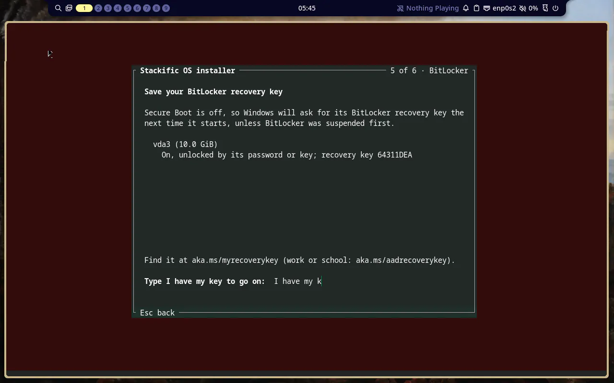
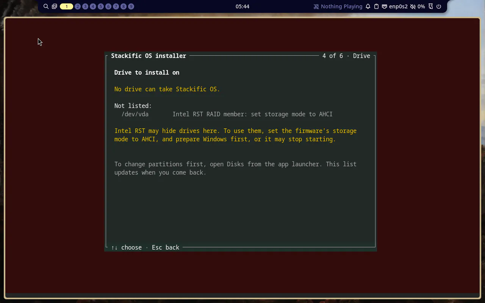
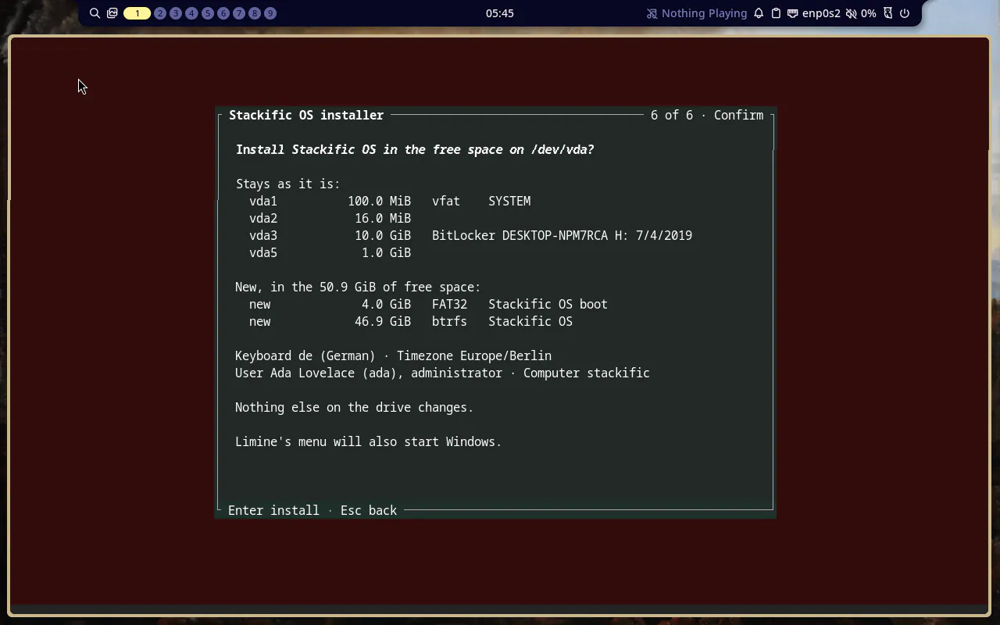
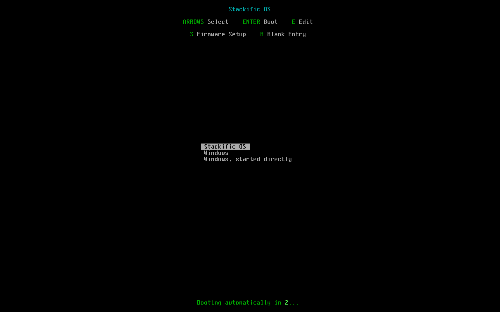

## Goal

The installer warns about every BitLocker volume and asks for a typed confirmation before it writes, installs next to BitLocker, refuses RST RAID members and BIOS-mode Windows with guidance, and writes Windows entries into Limine's menu that survive kernel updates on Fedora. The install tests on both x86_64 images prove it, down to starting a fake Windows through both entries.

## Context

Tasks 012 to 014 built the installer on both x86_64 images. Next to Windows it only refused: any BitLocker partition closed the free space, and Limine's menu had no Windows. This step turns the refusal into a confirmation that names the recovery key Windows will ask for, adds Windows to Limine's menu without touching Windows' own partition or firmware entry, and explains the two setups it cannot install next to.

## Expectations

Must:

- `just installer test` and `just installer lint` pass. Unit tests cover:
  - each `bitlkDump` fixture's state and key IDs (`64311DEA` for `bitlk-aes-xts-128`; two IDs for two-recovery; suspended for clear key; armed with no key for the TPM fixture);
  - the RST exclusion and its order before the in-use check, `remapped_nvme` above and at 0;
  - the BIOS-mode reason on an MBR Windows table and "no GPT partition table" on an MBR table without Windows;
  - free space next to BitLocker allowed;
  - `windows_entries` for no Windows, one ESP with and without the firmware entry, and two ESPs;
  - the Fedora file and the Arch `limine.conf` text;
  - the unattended phrase required, wrong and right.

  The snapshots match the new and changed screen fixtures. `just installer demo` shows the BitLocker screen and runs to Done.

- `just arch packages` and `just fedora packages` build; `rpm -qpR` of `stackific-installer` lists `cryptsetup`; the PKGBUILD's `depends` has it.
- `just arch iso`, `just fedora iso` build and print their sizes; the Fedora manifest lists `cryptsetup`.
- `just arch test-install` and `just fedora test-install` pass, each with:
  - **MBR Windows:** `/dev/vda` with a `dos` table, partition 1 type `07` holding `bitlk-aes-xts-128.img`. An unattended free-space run exits 2 with `MBR2GPT` on stderr, and `sfdisk --dump` is unchanged. (The erase earlier in the run already proves an MBR drive can be erased.)
  - **BitLocker on the Windows-like GPT:** `bitlk-aes-xts-128.img` written to partition 3 (replacing the fake signature). The ESP holds `EFI/Microsoft/Boot/bootmgfw.efi` (a copy of the image's Limine program) and an empty `BCD`, and the firmware has "Windows Boot Manager" for it (`efibootmgr --create --disk /dev/vda --part 1 --label "Windows Boot Manager" --loader '\EFI\Microsoft\Boot\bootmgfw.efi'`, made before the install).
    - A free-space run without `bitlocker` exits 2, names `vda3` and `64311DEA` on stderr, and changes nothing.
    - The run with `bitlocker = "I have my key"` installs. Every old entry stays byte-identical, partition 3's first 100 MiB have the same SHA-256 as the image, and the Windows ESP's file list and checksums are unchanged.
    - After the install, `efibootmgr` shows `BootOrder` starting with "Stackific OS", then "Windows Boot Manager".
  - **The installed boot:** `limine.conf` ends with the "Windows" and "Windows, started directly" entries naming partition 1's PARTUUID. On Fedora they are still there after the plugin's `kernel-install add` and `remove` and the offline kernel reinstall.
  - **Both Windows entries start the fake Windows:** the test then adds a `limine.conf` beside the fake `bootmgfw.efi`, whose one entry starts the installed kernel from `guid(<our ESP's PARTUUID>)` with `stackific.test=windows` added. Picking "Windows" in Limine's menu (key presses) restarts into it: `/proc/cmdline` has the marker and `efibootmgr`'s `BootCurrent` is the "Windows Boot Manager" entry. Picking "Windows, started directly" also reaches the marker, with `BootCurrent` the "Stackific OS" entry.
  - `limine.png` shows the Windows entries below Stackific OS.
- `just arch screenshots` saves the BitLocker screen, the Drive screen with an `isw_raid_member` drive (an imsm container made in the guest with `IMSM_NO_PLATFORM=1 mdadm --create … --metadata=imsm`, then stopped and wiped), and Confirm with the Windows line. The remapped-NVMe line appears only in its snapshot fixture, because a VM cannot fake it, and the prompt trail says so.
- `just arch test` and `just fedora test` still pass; `just lefthook all` passes (shellcheck on the plugin and the scripts, `just dev check`, the site's checks).

Must not:

- write to any partition, ESP or firmware entry other than our two new partitions and our own firmware entry: no `EFI/Microsoft` on our ESP, no change to "Windows Boot Manager" or `BootOrder` beyond `efibootmgr --create`;
- mount any partition read-write outside the target, mount NTFS at all, or unlock BitLocker;
- use os-prober, `limine-scan`, limine-entry-tool, mdadm assembly or any AUR or COPR package;
- refuse the free space for BitLocker, or change when the free space or the erase is offered other than the RST and BIOS-mode reasons;
- add the installer or Windows support to either aarch64 image (task 018);
- touch files outside the Changes list, or add a dependency this task does not name (`cryptsetup` is the one).

## Prompt

```text title="Prompt" wrap
Make the installer safe and complete next to Windows, on both x86_64 images (Arch and Fedora). Find BitLocker volumes on every drive, read each one's protectors with cryptsetup, and before anything is written show one screen that says what Windows will do at its next start and which recovery key it will ask for, or that no recovery key exists. Then require a typed confirmation, "I have my key", which also lets the free space next to BitLocker be used. Find Windows by its loader on any EFI System Partition, read-only, and add Windows to Limine's menu: a default entry that restarts into the firmware's "Windows Boot Manager" (Limine's efi_boot_entry, so BitLocker does not ask for its key after Limine updates) and a fallback entry that starts Windows' loader directly. Keep these entries when Fedora's kernel-install rewrites limine.conf, and keep Windows' firmware entry in the boot order. Refuse, with guidance, what we cannot install next to: Intel RST RAID members (switch the firmware to AHCI, prepare Windows first) and Windows on an MBR drive, which starts in legacy BIOS mode (convert with MBR2GPT.EXE first). Erasing such a drive stays allowed. Say when Intel RST hides NVMe drives. No os-prober, no entries for other Linux installs, and no change to when the free space is offered. Prove it in both bases' install tests with real BitLocker volumes made by Windows (cryptsetup's test images), an MBR Windows-like drive, and a fake Windows Boot Manager that the installed system starts through both Limine entries. Add a user page, "Next to Windows": save the BitLocker key, Fast Startup off, Secure Boot off, starting Windows from Limine, putting Stackific OS first again after a big Windows update, and Windows' clock (RealTimeIsUniversal).
```

## Outcome

- **BitLocker** (`installer/src/bitlocker.rs`): every partition `blkid -p` calls BitLocker, on every drive the install keeps, is read with `cryptsetup bitlkDump`. A clear key means suspended, a TPM protector means Windows will ask for its recovery key now that Secure Boot is off, and the recovery-passphrase protectors' GUIDs give the key IDs Windows shows (first 8 characters). A new BitLocker screen between Space and Confirm lists each volume and goes on only once `I have my key` is typed; the unattended file takes it as `[disk] bitlocker`. BitLocker no longer refuses the free space.
- **Windows** (`installer/src/windows.rs`): each EFI System Partition is mounted read-only to look for `EFI/Microsoft/Boot/bootmgfw.efi`, and efibootmgr's listing says whether "Windows Boot Manager" is in the boot order. Confirm says "Limine's menu will also start Windows."
- **Limine's menu** (`boot::windows_entries`): "Windows" restarts into the firmware's Windows Boot Manager (`efi_boot_entry`), written only when that entry exists, because Limine stops with an error otherwise; "Windows, started directly" chainloads `guid(<PARTUUID>):/EFI/Microsoft/Boot/bootmgfw.efi`. Arch appends them to its static `limine.conf`; on Fedora the installer writes `/etc/kernel/limine-windows.conf`, and stackific-boot's kernel-install plugin appends it each time it rewrites `limine.conf`.
- **Refusals**: an `isw_raid_member` drive is left out ("Intel RST RAID member: set storage mode to AHCI"), and the Drive screen adds how to switch without breaking Windows, also when RST hides NVMe drives (`remapped_nvme`); an MBR drive with an NTFS or BitLocker partition of type 7 refuses the free space as "BIOS-mode Windows: convert with MBR2GPT.EXE". Erasing such a drive stays allowed.
- **Packages**: `cryptsetup` joins the installer's dependencies on both bases (the Fedora image had only `cryptsetup-libs`).
- **Tests**: both bases' install tests use one of cryptsetup's test images, a BitLocker volume Windows made, written to the Windows-like table's partition 3, plus an MBR drive with Windows, and a fake Windows: Limine's own program as `bootmgfw.efi` with a "Windows Boot Manager" firmware entry. The installed system then starts that fake Windows through both Limine entries, checked by a kernel command-line marker and the firmware's `BootCurrent`.
- **Docs**: a new user page, Next to Windows (BitLocker key, Fast Startup, suspending BitLocker, Secure Boot, the installer's screens, RST and MBR2GPT, starting Windows, putting Stackific OS first again, Windows' clock); `docs/installer.md` for builders.

### Screenshots



_The BitLocker screen in the VM, for one of cryptsetup's volumes Windows made: its recovery key ID, where to find the key, and the typed confirmation._



_An Intel RST RAID member (an imsm container mdadm made in the VM) is left out, with the guidance below the list._



_Confirm next to Windows: what stays, what is new, and the line about Windows in Limine's menu._



_Limine's menu after the free-space install: both Windows entries below Stackific OS._

## Review

- **Round 1** found two things, both fixed. The fake-Windows boot test waited for the firmware in one-second steps, so its keys could reach Limine's menu after its 3-second countdown; it now polls every 0.2 s. The Windows page told users to turn BitLocker back on, which a suspension with `-RebootCount 1` already does by itself.
- **The screenshot run** then showed "BitLockerDESKTOP-NPM7RCA": a file system name wider than its column ran into the volume's label on Space and Confirm. The row now always keeps a space there, with a test, and both images were rebuilt and tested again.
- **Round 2** found nothing.

## Manual changes

None.

## Result

- `just installer test`: 66 tests pass (BitLocker classification from four `bitlkDump` fixtures, the RST and BIOS-mode reasons, Windows detection and its firmware-entry rule, the Windows entries on both bases, the unattended phrase, and snapshots of the BitLocker, Drive (RST) and changed screens); `just installer lint` passes; `just installer demo` shows the BitLocker screen.
- `just arch iso`: 1545 MiB; `just arch test` passes; `just arch test-install` passes: BIOS-mode Windows refused naming `MBR2GPT`, BitLocker refused without the phrase naming `vda3` and `64311DEA`, the install with it leaving the BitLocker volume, Windows' ESP and its firmware entry untouched, then the installed system starting the fake Windows through "Windows" (`BootCurrent` Windows Boot Manager) and "Windows, started directly".
- `just fedora iso`: 1497 MiB, with `cryptsetup` 2.8.8 in the manifest; `just fedora test` and `just fedora test-install` pass the same checks, and Limine's menu keeps the Windows entries through `kernel-install add`, `remove` and the kernel package's reinstall.
- `just arch screenshots` saves the BitLocker, Drive (RST) and Confirm screens shown above.
- `just lefthook all` passes.
- Docs: `site/src/content/docs/user/windows.md` (new), `site/src/content/docs/user/installation.md`, `docs/installer.md`, `release/notes.md`, `AGENTS.md`.

## Deviations

- BitLocker and Windows are looked for on every drive the installer lists, not on the drives it leaves out (under 40 GiB, read-only, in use): the scan reuses the drives already read. `docs/installer.md` lists it under Later.
- The BitLocker screen shows the volumes that fit and then how many more, instead of a scrolling list; the unattended refusal lists them all.
- BitLocker's states are three, not two: a volume protected only by a password, smart card or startup key is "On, unlocked by its password or key", because Windows asks for those as before. The test image is such a volume, so the VM shows that line with its recovery key.
- The RST and BIOS-mode reasons are shorter than the task's wording, to fit the Drive and Space screens; the Drive screen's line carries the rest.
- The MBR Windows and RST unit cases use inline JSON instead of new fixture files.
- `vm_put` sends the file as base64 in a here-document instead of raw bytes after a `head -c` command.
- The remapped-NVMe line shows in its snapshot only (`drive-rst.txt` with both cases), because a VM cannot fake it; the screenshot shows the line for an RST member.
- The task file was not changed.
