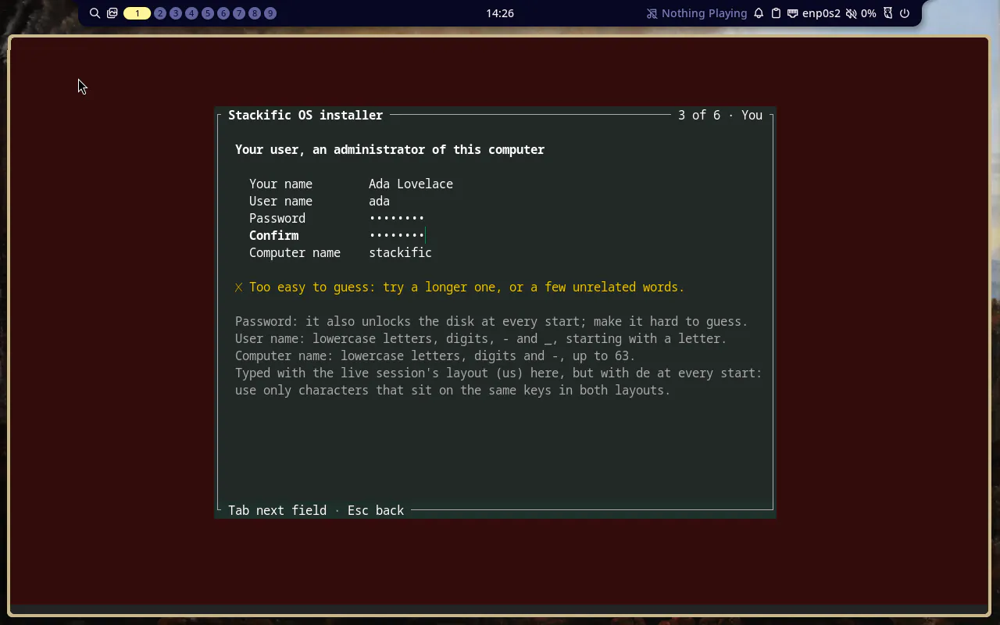
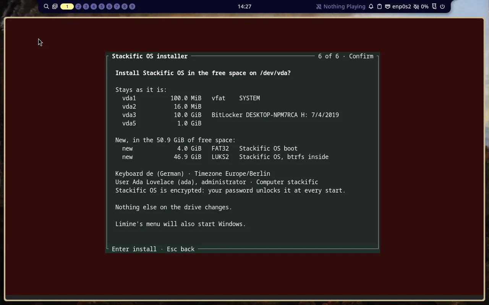
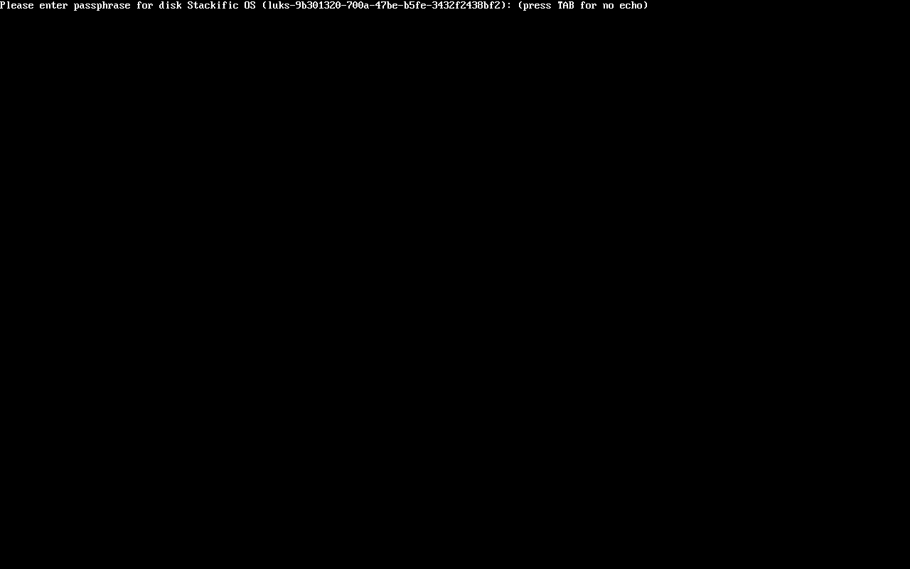
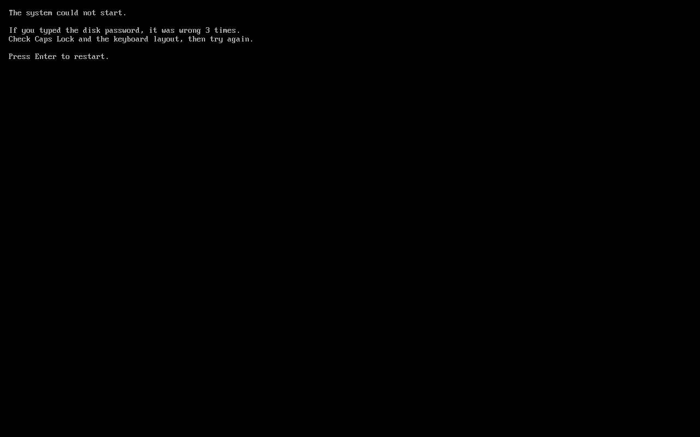

## Goal

Every install, in both modes, writes a LUKS2 container on the Stackific OS partition with btrfs inside it, unlocked at boot by the login password through the systemd initramfs, and refuses weak passwords. The install tests on both x86_64 images prove the encrypted system starts through a credential, through the typed passphrase on the German layout, and shows the plain screen after three wrong passphrases.

## Context

Tasks 012 to 015 built the installer on both x86_64 images, with btrfs straight on the system partition and any non-empty password accepted. This step encrypts the partition with no opt-out, makes the login password the disk passphrase and requires it to be hard to guess, and replaces systemd's emergency shell in the installed system's initramfs with a screen that says what went wrong.

## Expectations

Must:

- `just installer test` and `just installer lint` pass, with tests for the luksFormat and open commands (password on stdin, no newline), the command line, Arch's hooks drop-in, the strength check (a weak password refused, a strong one accepted, the user name counted as guessable) and closing the mapping after a failure.
- The installed system's partition 2 (free-space mode) is `crypto_LUKS` version 2 with one keyslot that the test password opens, and btrfs is inside it (`install.sh`).
- An unattended install with a password scoring below 3 exits 2 and names the password (`install.sh`).
- The installed system boots with `/proc/cmdline` holding `rd.luks.uuid=<uuid> root=/dev/mapper/luks-<uuid> rootflags=subvol=/@ rw`; `/` is btrfs on `/dev/mapper/luks-<uuid>`; on Arch the initramfs has `systemd-cryptsetup` and the boot-failure drop-in, on Fedora `lsinitrd -m` lists `systemd-cryptsetup` and `stackific-boot-failure` (`installed.sh`, both bases).
- Typed unlock (`unlock.sh`, both bases): three wrong passphrases leave the VM on the plain screen with no restart; Enter restarts it; the right passphrase, typed with the German layout, starts the system.
- Every existing install and installed-system check still passes, including both Windows entries (which now unlock through the credential).
- The You screen refuses a weak password, and its help and the Confirm screen mention encryption (snapshots, screenshots).

Must not:

- offer a way to install without encryption, or enrol a TPM, FIDO2 key or key file;
- change the live images' initramfs or emergency mode, or the installed system's own emergency mode;
- log the password (the existing journal check in `install.sh` stays);
- touch files outside the Changes list, or add a dependency other than `zxcvbn`.

## Prompt

```text title="Prompt" wrap
Encrypt every install of Stackific OS, on both x86_64 images (Arch and Fedora), with no opt-out: the installer puts LUKS2 on the Stackific OS partition and btrfs inside it, and the user's login password is also the disk passphrase, typed at every start. Refuse a password that is too easy to guess, using zxcvbn (score 3 of 4 or better, with the user's name, user name, computer name and the product name counted as guessable), on the You screen and in the unattended answers, and say on the screen that the password also unlocks the disk. Unlock with a passphrase only, no TPM. Use the systemd initramfs on both bases: on Arch add mkinitcpio's sd-encrypt hook, on Fedora dracut's own systemd-cryptsetup module, with the keyboard layout the user chose at the passphrase prompt. Name root by the unlocked mapping (root=/dev/mapper/luks-<uuid>), so a failed unlock fails at once. Keep the passphrase prompt alone on the screen: quiet on the command line, and /etc/crypttab with the container so Fedora's dracut adds no unlock job of its own. The installer reads the password with the live session's US layout while the boot prompt uses the chosen one, so when they differ, say on the You screen to use only characters on the same keys in both. After three wrong passphrases show a plain screen instead of systemd's emergency shell: what went wrong, check Caps Lock and the keyboard layout, press Enter to restart. Put it only in the installed system's initramfs, never the live image's. Tests unlock the installed system with systemd's cryptsetup.passphrase credential, and one boot types the passphrase with the German layout (a password with a y, which sits on the US z key), after three wrong ones that must show the plain screen. Docs say what encryption protects (a lost or stolen computer) and what it does not (someone changing the computer while you are away), and how to change the disk passphrase.
```

## Outcome

The installer puts LUKS2 on the system partition with cryptsetup's defaults (argon2id, 2 seconds), opens it, and writes btrfs and everything after it inside. The password reaches cryptsetup on stdin and is never logged. The You screen and the unattended check refuse a password below zxcvbn's score 3, counting the user's names, the computer name and the product name as guessable. The help says the password also unlocks the disk; when the chosen layout is not the live session's `us`, the help also warns that the password should only use keys that type the same in both layouts.

Every installed system boots with `rd.luks.uuid=<uuid> root=/dev/mapper/luks-<uuid> rootflags=subvol=/@ rw quiet` and has `/etc/crypttab`. On Arch the installer adds `sd-encrypt` to mkinitcpio's default hooks through its own drop-in; on Fedora dracut picks `systemd-cryptsetup` itself. With `quiet` and the crypttab entry, the passphrase prompt is the only line on the screen. After three wrong passphrases, stackific-boot's initramfs screen replaces systemd's emergency shell and restarts on Enter. It is in the installed system's initramfs only, never the live image's.

The tests unlock the installed system with systemd's `cryptsetup.passphrase` credential. One last boot types three wrong passphrases, sees the plain screen stay, presses Enter, and types the right password on the German layout: its y sits on the US z key, so the boot proves the prompt uses the chosen layout.

### Screenshots



_A password that is easy to guess is refused, because it also unlocks the disk. With German chosen, the help warns that the installer reads the password with the US layout._



_Confirm shows the encrypted partition and says what the password does._



_The installed system's passphrase prompt on Arch: with `quiet` and `/etc/crypttab`, it stands alone (Fedora's is the same)._



_After three wrong passphrases: a plain message instead of the emergency shell, and Enter restarts._

## Review

- Round 1 found two things, both fixed:
  - **Keyboard layout (must fix):** the installer reads the password with the live session's US layout, but the boot prompt uses the chosen layout. On German, the key labelled Y would store z, so the disk would never unlock. The You screen and the user page now warn about this when the layouts differ. Typing in the chosen layout is listed for later.
  - **Hidden prompt:** the passphrase prompt was buried under boot messages, and on Fedora a dracut error line followed it. Fixed with `quiet` and `/etc/crypttab`.
- Round 2 found nothing.

## Manual changes

None.

## Result

- `just installer test`: 66 tests pass, among them the luksFormat and open commands with the password on stdin, `/etc/crypttab`, the command line, Arch's hooks drop-in, the strength check and closing the mapping after a failure; `just installer lint` passes.
- `just arch iso`: 1546 MiB; `just arch test`, `just arch test-install` and `just arch screenshots` pass.
- `just fedora iso`: 1498 MiB; `just fedora test` and `just fedora test-install` pass.
- The install tests on both bases check:
  - a weak password refused with exit 2;
  - LUKS2 version 2 opened by the password, with btrfs inside;
  - the command line, `/etc/crypttab`, and the unlock and boot-failure pieces in each initramfs;
  - both Windows entries, unlocking through the credential;
  - the typed boot: three wrong passphrases, the plain screen with no restart, Enter, then the German-layout password.
- `just lefthook all` passes.
- Docs: `site/src/content/docs/user/installation.md` (Encryption: what it protects, the prompt, the layout, changing the disk password), `docs/installer.md`, `release/notes.md`, `AGENTS.md`.

## Deviations

- The command line also has `quiet`, and the installer writes `/etc/crypttab`. Both came from review round 1, so the prompt stands alone. The task's criteria name the command line's start, which is unchanged.
- The You screen warns when the chosen layout differs from the live session's. It does not type the password in the chosen layout; that is listed under Later in `docs/installer.md`.
- `stackific-boot` requires `cryptsetup` on both bases instead of the Fedora image listing it, so installed systems keep it wherever the package goes. The script and drop-in live in `installer/initramfs/`, shared by both packages, and `release/justfile` watches that folder. The task file was updated for both.
- The typed-unlock boot waits a fixed 30 seconds for the prompt instead of detecting it: the cursor blinks, so screenshots never settle. If the boot is slower, the test fails rather than passing wrongly.
