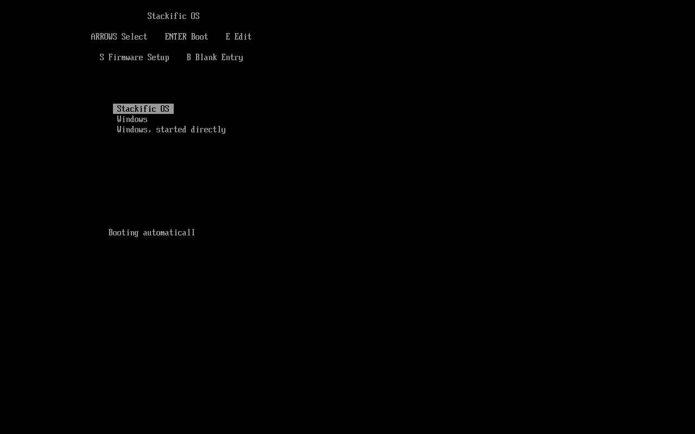
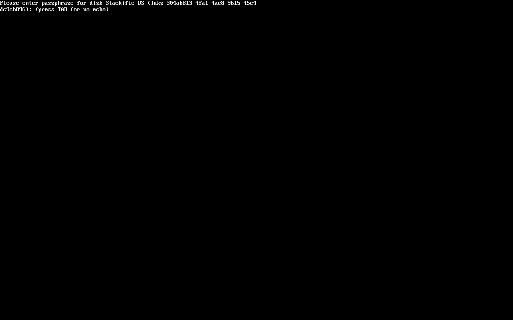
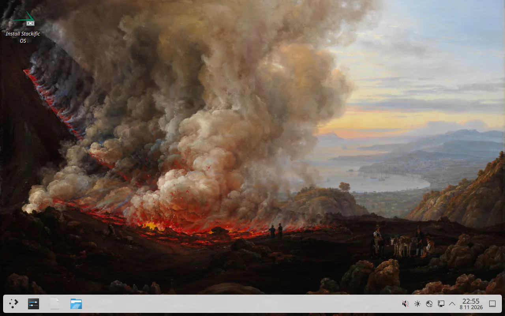
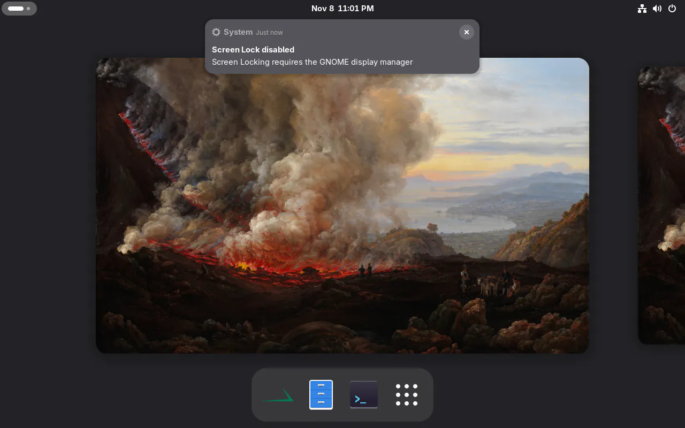

## Goal

Both aarch64 ISOs carry what the x86_64 ISOs carry for installing, and an install boots on its own through Limine from our ESP, as on x86_64.

## Context

Tasks 012 to 017 built the installer, Limine's boot chain, encryption and the Windows entries on both x86_64 images only. This step brings all of it to Arch Linux ARM and Fedora 45 aarch64. Each base's aarch64 kernel needed its own path to Limine, and Fedora's images gained GNOME Disks, which they had lacked on both architectures.

## Expectations

Must:

- `cargo test` in `installer/` passes on x86_64. Run on aarch64 (the Mac's runner VM, or `just arch packages` there, which builds the crate), the boot tests expect `\EFI\limine\BOOTAA64.EFI`.
- `just arch iso` and `just fedora iso` on aarch64 print each ISO's size. The packages lists (`.packages.txt`) include `stackific-installer`, `stackific-boot`, `limine`, `gnome-disk-utility` and `ntfsprogs`, plus `breeze-gtk` and `kde-gtk-config` on Arch. The Fedora x86_64 list gains `gnome-disk-utility`, `ntfs-3g` and `ntfsprogs` too.
- `just arch test` and `just fedora test` pass on aarch64 and on x86_64, with the installer, launcher, Disks and desktop-session checks from the shared check files. On aarch64 they leave `plasma.png` or `gnome.png`.
- `just arch test-install` and `just fedora test-install` pass on aarch64 and on x86_64:
  - the boot menu's Install entry reads "Install Stackific OS (aarch64, UEFI)";
  - the installed system boots from its disk alone through `\EFI\limine\BOOTAA64.EFI`, its LUKS2 root unlocked by the credential and, in the last boot, by the typed passphrase;
  - Limine's two Windows entries start the fake Windows;
  - stackific-boot's re-copy restores a truncated `BOOTAA64.EFI` at both ESP paths.
- On installed Arch aarch64, `/boot/Image` and `/boot/initramfs-linux.img` sit on the ESP, `limine.conf` names `boot():/Image`, and `/etc/pacman.d/hooks/stackific-vmlinuz.hook` is gone.
- On installed Fedora aarch64, every `limine.conf` kernel entry has `protocol: efi` and `cmdline: initrd=\initramfs-<v>.img rd.luks.uuid=…`. A reinstalled `kernel-core` writes the same.
- On installed Fedora aarch64, no `grub2-efi-aa64*` package is installed.
- The `images` workflow started by hand passes all four jobs, with `test-install` in the two aarch64 ones.
- `just lefthook all` passes.

Must not:

- change what an x86_64 image boots or installs (its `limine.conf` entries and file names stay as they are; its package lists change only by Disks on Fedora);
- copy Arch's `/boot/dtbs` to the ESP: ACPI machines do not need them, and `linux-aarch64`'s next upgrade writes them. The improvements list in `docs/installer.md` notes that `pacman -Qk linux-aarch64` reports them missing until then;
- unpack Fedora's zboot kernel, or add Limine's `$` gzip path;
- add a package to an image beyond the seven named for Arch aarch64 and the three Disks packages for Fedora;
- touch files outside the Changes list.

## Prompt

```text title="Prompt" wrap
Bring the installer to both aarch64 images, Arch Linux ARM and Fedora 45, as the docs reserve task 018 for: stackific-installer, stackific-boot with Limine's BOOTAA64.EFI, GNOME Disks with ntfs-3g and ntfsprogs (on both Fedora images too, which lack it although AGENTS.md puts Disks on all four), Plasma's GTK integration on Arch, the "Install Stackific OS" launcher and desktop shortcut, and the boot menu's Install entry. An install onto free space or a whole drive, encrypted, next to Windows or not, must boot on its own through Limine from our ESP, as it does on x86_64. Prove it with the AAVMF boot, session and unattended-install tests, run on the Mac's runner VM by the images and release workflows.
```

## Outcome

The installer picks Limine's program when it is built: `BOOTAA64.EFI` on aarch64, the UEFI fallback name for the architecture, at `\EFI\limine\` and `\EFI\BOOT\` on our ESP. stackific-boot's pacman hook and RPM trigger pick it with `uname -m`, so both packages stay architecture-independent.

Each base's aarch64 kernel needed its own way onto the ESP:

- **Arch Linux ARM** installs its kernel straight to `/boot/Image`, and mkarchiso empties the live root's `/boot`. So the installer copies the kernel from the ISO (`arch/boot/aarch64/vmlinuz-linux`, the live hook's copy of `/boot/Image`) to `/boot/Image`, the path the package owns. It then runs `mkinitcpio -P` for `/boot/initramfs-linux.img`, and `limine.conf` names `boot():/Image`. Later kernel upgrades write `/boot/Image` themselves. The live image's copy hook is removed from installed systems.
- **Fedora**'s aarch64 kernel is an EFI zboot image, which Limine's `linux` protocol refuses. stackific-boot's plugin writes aarch64 entries with `protocol: efi` and `cmdline: initrd=\initramfs-<version>.img …`. Limine starts the kernel as an EFI program, which unpacks itself and loads the initramfs from the ESP. The installer also removes the aarch64 GRUB packages.

On aarch64 the installed command line ends with `console=tty0`, on both bases. Without it, Linux on arm64 makes the serial port in ACPI's SPCR table the console. QEMU, UTM and many boards have one, so systemd asked for the passphrase there, and the screen stayed black. x86_64's command line is unchanged.

The Arch aarch64 image gains the installer, stackific-boot, Disks with NTFS tools and Plasma's GTK integration. The Install boot entry and the desktop shortcut stay on it. Both Fedora images gain Disks with `ntfs-3g` and `ntfsprogs`, and Fedora aarch64 gains the installer and its Install entry.

The x86_64-only check files went into the shared `arch.sh` and `fedora.sh`. `boot.sh` gives the check files Limine's file name. The aarch64 VM gets a USB keyboard, and the ISO goes in as a SCSI CD (`/dev/sr0`), because `virt` has no IDE and `-cdrom` would make it the first virtio disk, `/dev/vda`, ahead of the test disk. The aarch64 jobs of `images` and `release` now run `test-install`.

### Screenshots

No installer screen changed: the screens are the same on every architecture. These come from the aarch64 runs in the Mac's runner VM.



_An install next to Windows on aarch64 starts from `\EFI\limine\BOOTAA64.EFI`, with both Windows entries after the system's._



_With `console=tty0`, the prompt is on the screen; before it, only the serial port showed it._



_The aarch64 live desktop now has the installer's shortcut._



_The installer is first in GNOME's dash on Fedora aarch64._

## Review

- **Round 1** found two problems, both on aarch64 only, and both are fixed:
  - **Must fix:** QEMU's `virt` machine has no keyboard, so no key press reached the VM: the GNOME login, the installer's console keys, Limine's menu and the typed passphrase. The aarch64 VM now has a USB keyboard.
  - **Must fix:** Arch Linux ARM's packages end in `.pkg.tar.xz`, so the Limine re-copy check's `.pkg.tar.zst` glob found nothing. Both places now take `.pkg.tar.*`.
- **Round 2** found nothing.
- **Round 3** came from the x86_64 test run. The wider glob also took the package's `.sig` file, which `pacman -U` then failed on. The recipe now deletes the downloaded signatures.
- **Round 4** found nothing.
- **Round 5** came from the installer's tests on the Mac, an aarch64 host. One test still expected Arch's `vmlinuz-linux`, which aarch64 names `Image`, so `cargo test` failed there, and with it both installer package builds. The test now takes the names from `Arch.kernel_files()`.
- **Round 6** found nothing.
- **Round 7** came from the first aarch64 run in the VM. `virt` has no IDE, so the ISO became `/dev/vda` and the installs' blank-disk check failed. The ISO is now a SCSI CD.
- **Round 8** came from the second run:
  - **Must fix:** the passphrase prompt went to SPCR's serial port, so a keyboard could not unlock an installed aarch64 system. The command line gains `console=tty0` on aarch64.
  - **Must fix:** the `limine.conf` check missed Fedora aarch64's `initrd=` prefix. The checks now build the expected command line once.
- **Round 9** found nothing.

## Manual changes

The aarch64 runs were made in the Mac's runner VM, from the branch with the working tree's fixes applied. Rounds 7 to 9 change `tests/vm/` and the installer for x86_64 too, without changing x86_64's behaviour, so `just arch test-install` and `just fedora test-install` run on the PC once more before the merge, or the `images` workflow started by hand runs them.

## Result

- `just lefthook all` passes: 66 installer tests, clippy, shellcheck, actionlint, and the site's build and checks. `cargo clippy --all-targets --target aarch64-unknown-linux-gnu -- -D warnings` passes; the aarch64 tests run in the package build (`check()`, `%check`) on the Mac.
- x86_64, unchanged in behaviour:
  - `just arch iso` makes a 1553 MiB ISO, and `just arch test` and `just arch test-install` pass with the shared check files. The installed system has no `stackific-vmlinuz.hook`.
  - `just fedora iso` makes a 1502 MiB ISO with Disks (1497 MiB before), and `just fedora test` (Disks and `ntfsresize` included) and `just fedora test-install` pass.
- aarch64, in the Mac's runner VM:
  - `just arch iso` makes a 1345 MiB ISO; `just arch test` and `just arch test-install` pass.
  - `just fedora iso` makes a 1445 MiB ISO; `just fedora test` and `just fedora test-install` pass.
  - Each install boots from its disk alone through `\EFI\limine\BOOTAA64.EFI`, starts both Windows entries, and unlocks with the credential and, in the last boot, with the typed passphrase.
- Docs: `docs/installer.md`, `docs/arch-iso.md`, `docs/fedora-iso.md`, `docs/checks.md`, `site/src/content/docs/user/installation.md`, `release/notes.md`, `AGENTS.md`.

## Deviations

- Both Fedora images gain GNOME Disks, `ntfs-3g` and `ntfsprogs`. `AGENTS.md` puts Disks on all four images, but Fedora had none. The task was updated before the build.
- The aarch64 jobs' timeout in `images` and `release` went from 90 to 150 minutes, because they now also install. That is in the workflows the task lists.
- `tests/vm/screens.sh` and the Arch recipe's comment use the per-architecture names too.
