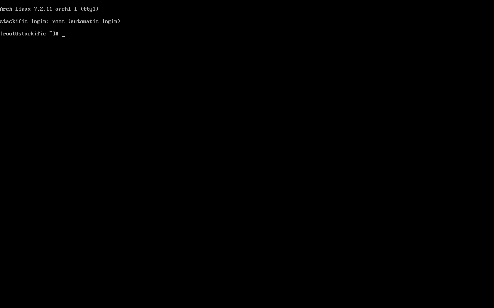

## Goal

`just arch iso` builds a bootable console live ISO for Arch x86_64 in a pinned container, and `just arch test` boots it under QEMU with OVMF and proves it reached a running, logged-in console.

## Context

Before this step, the repo had tooling, checks and the site, but no image. This step adds the Arch builder container, the archiso profile and a VM boot test. The test reaches the VM only through one-boot SMBIOS credentials, so the image ships no test units and no sshd.

## Expectations

Must:

- `just arch iso` exits 0 on a Linux host with rootless podman. It writes `.build/arch/x86_64/stackific-0.0.0-dev-arch-x86_64.iso` and `.build/arch/x86_64/stackific-0.0.0-dev-arch-x86_64.packages.txt`, and its last line prints the ISO size in MiB.
- The manifest lists `linux 7.2.11.arch1-1` and `systemd 262.1-1`, which proves the 2026-11-01 archive pin.
- `just arch test` exits 0. While it runs, checks over the vsock shell print:
  - `running` for `systemctl is-system-running`;
  - `root` on `tty1` for `who`;
  - `running` for `nmcli -t -f RUNNING general`.
- `just arch test` leaves the screenshot `.build/arch/x86_64/screen.png` showing the root shell prompt on tty1, and `.build/arch/x86_64/serial.log`.
- A connection to the test shell's vsock port with a wrong token gets no shell: `echo bad; echo id` prints nothing and the connection closes.
- `just doctor` prints one `arch:` line naming the podman version and the `/dev/kvm` and `/dev/vhost-vsock` state, and fails with a hint when one is missing.
- `just lefthook all` passes (shellcheck on `tests/vm/boot.sh` and `arch/iso/profiledef.sh`, justfiles parse, docs build).
- The task report states the ISO size in MiB against the 2048 MiB target.

Must not:

- ship `openssh`, `cloud-init`, VM guest agents, syslinux or GRUB in the image (absent from the manifest), or any file from `tests/` in the image;
- use sudo or root on the host for the build or the test;
- leave a stale archiso work dir that makes a rebuild skip steps;
- add `NOPASSWD` or a polkit rule anywhere;
- touch files outside the Changes list (the review record and prompt-trail entry from /s-build excepted);
- add a dependency this task does not name, or add the CI workflow or a self-hosted runner, which is a separate chore.

## Prompt

```text title="Prompt" wrap
Build the first Stackific OS image: an Arch Linux x86_64 live ISO, console only (kernel, firmware, microcode, btrfs and FAT tools, NetworkManager, root autologin on tty1; no desktop, branding or hardware detection yet). Build it with archiso v92 inside a pinned archlinux/archlinux container, with every package from one pinned Arch Linux Archive date (2026-11-01). Run the build under rootless podman, never sudo, and give every build a fresh archiso work dir. Boot it with archiso's systemd-boot mode, UEFI only. Name it stackific-<version>-arch-x86_64.iso, record its package manifest next to it, and report its size against the 2 GiB target.

Add a QEMU/OVMF boot test that runs in the same container. It reaches the VM only through one-boot SMBIOS credentials: systemd.extra-unit.* credentials add a vsock socket and service, a systemd.unit-dropin.sockets.target credential starts the socket, and a random token arrives as a credential through a 0600 file, so it never shows on a command line. The service runs bash on a connection only when its first line is non-empty and equals the token. The image ships no test units and no sshd. Wait for the end of boot through that shell with `systemctl is-system-running --wait`; do not use vmm.notify_socket, because over vsock it opens one connection per message and drops some, READY=1 included. Then check that the system is running, root is logged in on tty1, NetworkManager is running and a wrong token gets no shell. Save a console screenshot and the serial log, then power the VM off.

Expose both as just recipes (`just arch iso [version]`, `just arch test [version]`) that run unattended on a local Linux PC. Take the version only as data, never pasted into shell code, and refuse one that is not semver. Add an `arch:` line to `just doctor` for podman, /dev/kvm and /dev/vhost-vsock, list them as Linux prerequisites in the README (with what to do where the devices are not 0666), and document the build, the test and how to move the archive date.
```

## Outcome

`just arch iso` builds the builder image from `arch/Containerfile` (archiso, QEMU, OVMF and socat from the archive date), then runs `mkarchiso` on `arch/iso/`, a trimmed copy of archiso's baseline profile:

- systemd-boot only;
- releng's squashfs options;
- NetworkManager enabled;
- root autologin on tty1;
- serial console output for the test log.

`mkarchiso` runs as an unprivileged `build` user inside the container. Rootless podman cannot mount devtmpfs, so archiso has to use its user-namespace mode. The ISO is 898 MiB, well under the 2048 MiB target, and holds 181 packages.

`just arch test` runs `tests/vm/boot.sh`, which boots the ISO with KVM and passes the test shell in as SMBIOS credentials. It passed 10 boots out of 10, about 17 seconds each.

### Screenshots



_The live ISO after boot: root is logged in on tty1 with no password prompt, as the test's `who` check expects._

## Review

- **Round 1** found three things, all fixed:
  - a recipe comment still named the removed READY listener;
  - the test shell would accept an empty first line if the token credential were ever missing, so it now also requires a non-empty line;
  - the `version` argument was pasted into host and container shell code, so a quote in it could run commands. Both recipes now take it as data, and `just arch iso` refuses anything that is not semver.
- **Round 2** found that the README called podman optional while `just doctor` (run by `just setup`) fails without it on Linux. It also claimed every systemd host makes `/dev/kvm` 0666. The line now says what Linux needs, and how to get device access where the default is 0660.
- **Round 3** found nothing.

## Manual changes

None.

## Result

The repo now builds and boot-tests its first image:

- `arch/` holds the builder container, the pins and the archiso profile.
- `tests/vm/` holds the base-neutral boot test and its two credential-injected units.
- `just arch iso`, `just arch test` and an `arch:` doctor line wire them in.

Verified on a Linux host with rootless podman 6.1.4:

- `just arch iso` exits 0 twice in a row and prints `898 MiB (target 2048 MiB)`. The manifest has 181 packages, including `linux 7.2.11.arch1-1` and `systemd 262.1-1`, and no openssh, cloud-init, guest agents, syslinux or GRUB.
- `just arch iso abc` and `just arch iso '1.0.0"x'` are refused with `version must be semver`.
- `just arch test` passed 10 of 10 boots before review and 4 of 4 after, about 17 s each. Every check printed `ok`: system `running`, root on `tty1`, NetworkManager `running`, wrong token rejected, screenshot saved.
- `just doctor` prints `arch: ok (podman 6.1.4, /dev/kvm and /dev/vhost-vsock read-write)`.
- These pass: hygiene, shellcheck, justfile parse, gitleaks on every new path, `just dev check`, and the site's format, lint, typecheck, screenshot and build checks. `just lefthook all` passes on the tracked files.

Docs: the new developer page **Arch ISO** (`developer/arch-iso.md`) covers the build, the boot test and how to move the archive date. `README.md` gains the image prerequisites and the two recipes, and `AGENTS.md` gains the builder and boot-test rules.

## Deviations

- The boot test waits on the vsock shell instead of systemd's READY notification. The operator chose this during the build after READY was missed in 2 of 10 boots; the task file was updated first.
- Three findings changed the implementation within the task's Changes list:
  - the builder image adds the unprivileged `build` user with a sub-ID range, and makes `newuidmap`/`newgidmap` setuid, because the base image ships them without their file capabilities;
  - `just arch test` runs its container with `--security-opt seccomp=unconfined`, because podman's default seccomp profile blocks `AF_VSOCK` sockets;
  - HMP's `screendump` takes `filename -f png`, not `-f png filename`.
- `AGENTS.md` also drops podman and QEMU with OVMF and AAVMF from the "Other tools" line, since podman is now a host prerequisite and QEMU ships in the builder. The task names only three `AGENTS.md` lines; the task file was not updated for this one.
