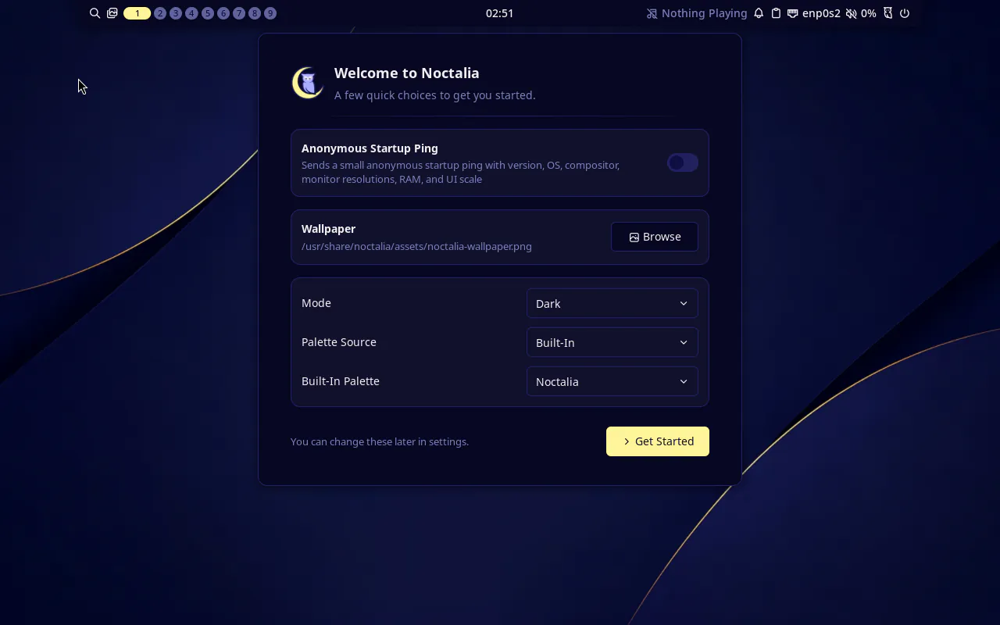
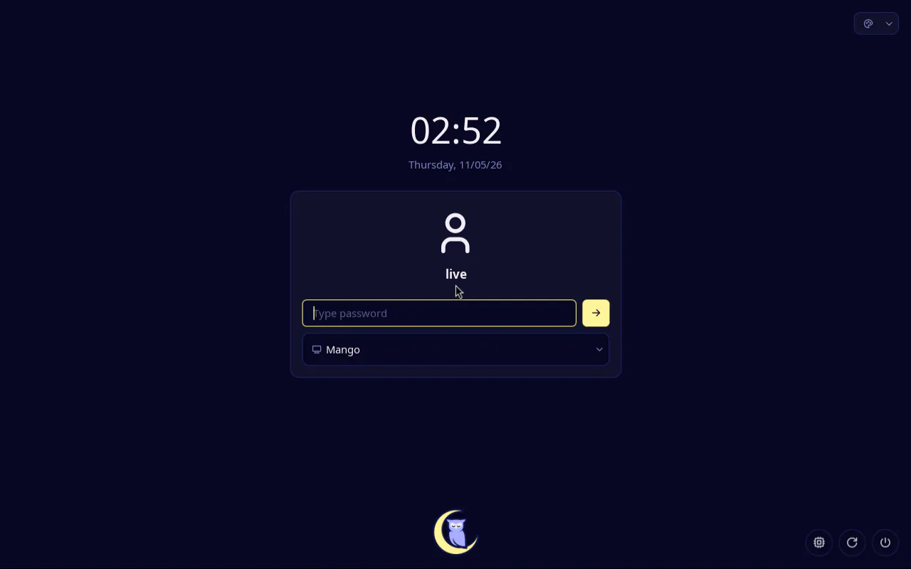

## Goal

`just arch iso` builds an Arch x86_64 live ISO that boots into MangoWM with Noctalia as the user `live`, with KDE Plasma available from noctalia-greeter. `just arch test` proves that session runs and that the greeter shows after a logout.

## Context

Before this step, the Arch ISO was console only: root logged in automatically on tty1, and the boot test checked that console. This step adds the desktop, all of it from Arch's own packages at the pinned archive date. It also adds a live user and greetd, and `stackific-desktop`, the first package we build. That package carries our desktop defaults.

## Expectations

Must:

- `just arch packages` exits 0 and leaves `.build/arch/repo/stackific-desktop-0.1.0-1-any.pkg.tar.zst` and `.build/arch/repo/stackific.db.tar.zst`. `bsdtar -tf` on the package lists `usr/lib/systemd/user/stackific-noctalia.service`, `usr/lib/systemd/user/mango-session.target.wants/stackific-noctalia.service` and `etc/profile.d/stackific-wlroots.sh`.
- `just arch iso` exits 0, and its last line prints the ISO size in MiB. The manifest `.build/arch/x86_64/stackific-0.0.0-dev-arch-x86_64.packages.txt` lists these packages at these versions: `stackific-desktop 0.1.0-1`, `mangowm 0.18.4-1`, `noctalia 5.4.1-1`, `noctalia-greeter 1.7.0-1`, `greetd 0.10.3-2` and `plasma-desktop 6.8.2-1`.
- `just arch test` exits 0, with these checks printed `ok`:
  - `running`;
  - greetd `active`;
  - `stackific-noctalia.service` `active` for `live`;
  - a `mango` PID for `live`;
  - both session files present;
  - a `noctalia-greeter` PID for `greeter` after the logout;
  - NetworkManager `running`;
  - wrong token rejected.
- `.build/arch/x86_64/screen.png` shows the MangoWM desktop with Noctalia's bar, and `.build/arch/x86_64/greeter.png` shows noctalia-greeter.
- `just lefthook all` passes.
- The task report states the ISO size in MiB against the 2048 MiB target.

Must not:

- change a file owned by mangowm, noctalia, noctalia-greeter or any Plasma package. Our only change to a package's `/etc` file is greetd's `config.toml`, and only in the live image;
- start Noctalia in the Plasma session;
- add `NOPASSWD`, a sudoers file or a polkit rule anywhere;
- keep the tty1 root autologin, or ship anything from `tests/`, `openssh`, `cloud-init`, syslinux or GRUB in the image;
- use sudo or root on the host;
- touch files outside the Changes list (the review record, prompt-trail entry and its screenshots from /s-build excepted);
- add a dependency this task does not name.

## Prompt

```text title="Prompt" wrap
Turn the Arch x86_64 console live ISO into a desktop live ISO, with every package from the pinned Arch Linux Archive date (2026-11-01) and every desktop package taken unmodified from Arch extra: mangowm, noctalia, greetd, noctalia-greeter, plasma-desktop with plasma-nm, plasma-pa, kscreen, konsole and dolphin, the KDE, GTK and wlr portals, PipeWire, and foot and rofi, which MangoWM's stock keybinds launch.

Add a live user `live` (UID 1000, empty password, in wheel through a sysusers.d `m` line, so the GID stays dynamic), keeping root's lines in the airootfs passwd, group, shadow and gshadow files; mkarchiso creates its home from /etc/skel. Drop the tty1 root autologin and enable greetd as the display manager. Its live-only config logs `live` into MangoWM through `[initial_session]`, and runs noctalia-greeter (/usr/bin/noctalia-greeter-session, user greeter) as `[default_session]`, so a logout lands on the greeter, where Plasma is the other session.

Do not edit MangoWM's config. MangoWM imports its environment into the user manager and starts mango-session.target itself, so start Noctalia from a user unit, stackific-noctalia.service, wanted by that target; Plasma never starts it. Ship that unit in our first package, stackific-desktop, from base-neutral sources in desktop/. In a VM without 3D, or with no working GPU driver, wlroots refuses Mesa's software renderer, and MangoWM, whose scenefx renderer is GLES-only, exits. So the package also ships /etc/profile.d/stackific-wlroots.sh, exporting WLR_RENDERER_ALLOW_SOFTWARE=1 everywhere; greetd sources /etc/profile for every session.

Build the package with a `just arch packages` recipe: makepkg as the unprivileged builder user in a fresh pinned builder container (add fakeroot to it), with the desktop/ files its source=() names staged next to the PKGBUILD, then repo-add into a local repo .build/arch/repo/. `just arch iso` runs it first and mounts the repo read-only, and the profile's pacman.conf reads it as [stackific] with SigLevel = Optional until release signing.

Extend the QEMU boot test. After the console checks, check that greetd is active, stackific-noctalia.service is active for live and mango runs as live, and that both session files exist; save screen.png. Then run `loginctl terminate-user live`, check that /usr/bin/noctalia-greeter runs as greeter (match the command line, because its comm name is cut to 15 characters), and save greeter.png. Report the ISO size against the 2 GiB target, and document the package step, the live session and the new checks.
```

## Outcome

The ISO now boots to a desktop. greetd logs `live` into MangoWM, and MangoWM starts `mango-session.target`, which pulls in `stackific-noctalia.service` from our package. Noctalia comes up with its first-run welcome dialog.

The first boot test failed: MangoWM exited 3 seconds after greetd started it, because wlroots refused the VM's software renderer. noctalia-greeter's compositor fell back to a CPU renderer and survived. The fix is the `WLR_RENDERER_ALLOW_SOFTWARE=1` profile.d script in `stackific-desktop`, set everywhere at the operator's choice.

The ISO is 1497 MiB against the 2048 MiB target, with 660 packages. The boot test passes in about 51 s, with 4 GiB of RAM; the session uses about 710 MiB of it.

### Screenshots



_The live session after boot: no login prompt, Noctalia's bar on MangoWM, and its first-run dialog with the anonymous ping off._



_After `loginctl terminate-user live`, greetd shows noctalia-greeter; the session picker also offers Plasma._

## Review

- **Round 1** found two small leftovers in the package recipe, both fixed. `makepkg --cleanbuild` did nothing, because every package builds in a new directory. A listing of the repo repeated what makepkg already prints. An extra VM run during the review confirmed that `live` is in `wheel` and owns its home, and that no `.pacnew` files are left in `/etc`.
- **Round 2** found nothing.

## Manual changes

None.

## Result

The Arch live ISO is now a desktop image:

- `stackific-desktop` (`arch/packages/`, files from `desktop/`) is our first package. It holds `stackific-noctalia.service` and `/etc/profile.d/stackific-wlroots.sh`.
- `just arch packages` builds it with makepkg in a fresh builder container into `.build/arch/repo/`, and `just arch iso` installs it from there as `[stackific]`.
- The profile adds the desktop packages, the user `live`, greetd with noctalia-greeter, and drops the tty1 root autologin.

Verified on a Linux host with rootless podman 6.1.4:

- `just arch packages` exits 0, and the package lists the unit, its `mango-session.target.wants` link and the profile.d script.
- `just arch iso` exits 0 and prints `1497 MiB (target 2048 MiB)`. The manifest has 660 packages, including `stackific-desktop 0.1.0-1`, `mangowm 0.18.4-1`, `noctalia 5.4.1-1`, `noctalia-greeter 1.7.0-1`, `greetd 0.10.3-2` and `plasma-desktop 6.8.2-1`. There is no openssh, cloud-init, syslinux or GRUB.
- `just arch test` passed 3 of 3 boots, about 51 s each, with every check `ok`. It left `screen.png` and `greeter.png`, shown above.
- `just doctor` passes.
- These pass: hygiene, shellcheck and gitleaks on every changed and new file, justfile parse, `just dev check`, and the site's format, lint, typecheck, screenshot and build checks.

Docs: the developer page **Arch ISO** (`developer/arch-iso.md`) gains sections on our packages and the live session, the new test checks, and the manual Plasma check. `README.md` gains `just arch packages`. `AGENTS.md` gains the package, Noctalia, software-rendering and live-session lines.

## Deviations

- The task did not foresee that MangoWM refuses software rendering. During the build the operator chose to allow it everywhere, and the task file was updated first: Context, Changes, the package criterion and its AGENTS.md line.
- Two ISO builds failed on archive download timeouts (`Operation too slow`), and the next one passed unchanged. The task file now lists a shared package cache among the later improvements.
