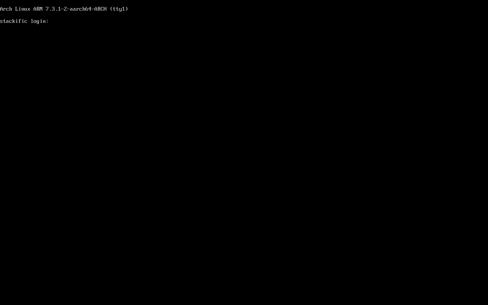

## Goal

On an aarch64 Linux host, `just arch iso` builds `.build/arch/aarch64/stackific-<version>-arch-aarch64.iso` from Arch Linux ARM's live repos, and `just arch test` boots it under QEMU with KVM and AAVMF and proves a running console. On x86_64 both recipes behave as before.

## Context

Before this step, the Arch image, its builder and its boot test were x86_64 only. The Mac's arm64 Linux VM (`just runner vm`) had just become a build host, with KVM through nested virtualization. This step makes the same profile, builder and recipes build and boot-test an Arch Linux ARM console image there.

## Expectations

Must:

- In the runner VM, `just arch iso` exits 0. It writes `.build/arch/aarch64/stackific-0.0.0-dev-arch-aarch64.iso` and `.build/arch/aarch64/stackific-0.0.0-dev-arch-aarch64.packages.txt`, and its last line prints the ISO size in MiB against 2048 MiB.
- The manifest lists `linux-aarch64` and `archlinuxarm-keyring`, which proves the image came from ALARM. It lists neither `amd-ucode` nor `intel-ucode`.
- The ISO's ESP holds `EFI/BOOT/BOOTAA64.EFI` (`mdir` on the efiboot image, or `xorriso -indev <iso> -find /EFI`).
- In the runner VM, `just arch test` exits 0. Over the vsock shell its checks print:
  - `running` for `systemctl is-system-running`;
  - `running` for `nmcli -t -f RUNNING general`;
  - `aarch64` for `uname -m`;
  - `active` for `systemctl is-active getty@tty1`.
- A wrong token gets no shell: `echo bad; echo id` prints nothing and the connection closes.
- `just arch test` leaves `.build/arch/aarch64/screen.png`, showing the tty1 login prompt, and `.build/arch/aarch64/serial.log`.
- A second `just arch iso` in a row rebuilds cleanly.
- On the operator's PC, `just arch iso` and `just arch test` pass on this branch, which proves the x86_64 image and its checks unchanged. `images` runs only on `main`, so it cannot prove this before the merge.
- After the merge, the `images` run on `main` passes `arch-aarch64` on the Mac's VM. The test release `v0.0.0-pr.<n>` then holds `stackific-0.0.0-pr.<n>-arch-aarch64.iso`, its `.packages.txt` and `.iso.sha256`.
- `just lefthook all` passes: shellcheck on `tests/vm/boot.sh`, `tests/vm/arch-aarch64.sh` and `arch/iso/profiledef.sh`, actionlint on both workflows, justfiles parse, `just dev check`.
- The task report states the aarch64 ISO size in MiB against the 2048 MiB target.

Must not:

- cross-build, emulate one architecture on another, or use qemu-user or binfmt;
- ship `openssh`, `cloud-init`, VM guest agents, GRUB or syslinux in the image (none in the manifest), or any file from `tests/`;
- use sudo or root on the host for the build or the test;
- change the x86_64 image's package list or its boot checks;
- pin ALARM packages beyond the builder base image digest;
- add `pull_request` or `workflow_dispatch` to `images.yml`, `NOPASSWD`, or a polkit rule;
- touch files outside the Changes list (the review record and prompt-trail entry from /s-build excepted), or add a dependency this task does not name.

## Prompt

```text title="Prompt" wrap
Build the aarch64 sibling of the Arch x86_64 live ISO: an Arch Linux ARM (ALARM) aarch64 console live ISO named stackific-<version>-arch-aarch64.iso. Build it natively on the Mac's arm64 Linux runner VM (`just runner vm`, Fedora with SELinux enforcing), never cross-built, with the same archiso profile and the same `just arch` recipes: the host's architecture picks the image. ALARM has no archive, so the image comes from ALARM's live repos and its package manifest is the record. Console only; a later task brings the desktop by growing `packages.aarch64`.

Use archiso v92, which builds aarch64 natively. ALARM packages neither archiso nor AAVMF, so the builder, based on docker.io/menci/archlinuxarm pinned by digest, installs Arch's `any` packages archiso 92-1 and edk2-aarch64 202608-1 from the existing Arch Linux Archive date, signature-checked after `pacman-key --populate archlinuxarm archlinux`. It also needs ALARM's QEMU display modules `qemu-hw-display-virtio-gpu` and `qemu-hw-display-virtio-gpu-pci`. pacman's Landlock sandbox fails in an unprivileged rootless `podman build` there, so its pacman calls use `--disable-sandbox`.

ALARM's kernel installs as /boot/Image, but mkarchiso takes boot/vmlinuz-*: add a pacman hook to the profile that copies it to /boot/vmlinuz-linux (a copy, because mkarchiso sizes the ESP with du). Use only the arm64 BCJ filter for the squashfs on aarch64, and name both serial consoles (ttyS0 and ttyAMA0) in the one boot entry. ALARM's makepkg writes .pkg.tar.xz, so the package recipe takes any .pkg.tar.* file. SELinux hides bind mounts and /dev/vhost-vsock from unprivileged containers, so the package build and the boot test run with `--security-opt label=disable`.

Make tests/vm/boot.sh pick QEMU, machine and default firmware from the architecture (q35 with OVMF, or virt with AAVMF and virtio-gpu-pci). Put the aarch64 checks in their own check file, tests/vm/arch-aarch64.sh, which boot.sh sources after the checks every image passes. It checks that `uname -m` prints aarch64 and getty@tty1 is active, and that tty1's text in /dev/vcs1 shows the `stackific login:` prompt before the screenshot.

Add an arch-aarch64 job on [self-hosted, Linux, ARM64] to the images workflow, which uploads the image to the test release after each merge to main, and to the release workflow. Make both publish jobs wait for it. Document the aarch64 build in docs/arch-iso.md, and report the ISO size against the 2 GiB target.
```

## Outcome

`just arch iso` and `just arch test` take the host's architecture from just's `arch()`. On aarch64:

- The builder comes from the same `arch/Containerfile`, which branches on `uname -m`. It keeps ALARM's mirrors, adds the Arch keys, installs fakeroot, QEMU with its virtio-gpu modules and socat from ALARM, and installs archiso and edk2-aarch64 from the archive date.
- The profile in `arch/iso/` serves both architectures: `arch="$(uname -m)"`, the BCJ filter by architecture, and a new `packages.aarch64` (base, `linux-aarch64`, firmware, the ALARM keyring, the archiso initramfs hooks, NetworkManager, btrfs and FAT tools).
- The pacman hook `stackific-vmlinuz.hook` copies `/boot/Image` to `/boot/vmlinuz-linux` during pacstrap, so mkarchiso finds the kernel and puts systemd-boot on the ESP as `BOOTAA64.EFI`.
- The image is 730 MiB, with 179 packages in its manifest, among them `linux-aarch64 7.3.1-2` and `archlinuxarm-keyring 20240419-2`.

`tests/vm/boot.sh` boots it on a `virt` machine with KVM, AAVMF in pflash, `virtio-gpu-pci` and the ISO as `-cdrom`. After the checks every image passes, it sources `tests/vm/arch-aarch64.sh`: the console checks, the wait for the login prompt in `/dev/vcs1`, and the screenshot. The x86_64 path keeps its machine, firmware and `tests/vm/arch-x86_64.sh`.

The `images` and `release` workflows each gain an `arch-aarch64` job on the Mac's runner VM. It builds and boot-tests the image and uploads the ISO, its manifest and its checksum. Both `publish` jobs wait for it.

### Screenshots



_The aarch64 live ISO at its tty1 login prompt under QEMU with KVM and AAVMF, on the Mac's runner VM. The kernel line names Arch Linux ARM's own kernel._

## Review

- Round 1 found one small issue. Called without the new third argument, `boot.sh` stopped on an unset variable before it could print its usage line. Fixed with `checks=${3-}`: it now prints the usage line and exits 2. The boot test passed again after the fix. The review could not check the x86_64 path, because the runner VM is aarch64; the manual `workflow_dispatch` run covers it.
- Round 2 found nothing.
- Round 3 reviewed the rebase onto `main` after tasks 003 and 004. It found nothing: the aarch64 checks moved to their own check file, both workflows gained the job, and the boot test passed again with `main`'s new test shell service.

## Manual changes

The build ran on the Mac's runner VM, driven from the Mac's checkout: files went into the VM's clone with `limactl copy` (later as one tar of the tree), and the recipes ran there with `limactl shell`. The operator registered the VM as a runner with `just runner setup` on the Mac. Still to do by hand:

- Before the merge, on the PC: `just arch iso` and `just arch test` on this branch must pass. `images` runs only on `main`, so it cannot prove the x86_64 path earlier.
- After the merge: the `images` run on `main` must pass every job, and `v0.0.0-pr.5` must hold the aarch64 ISO, its manifest and its `.iso.sha256`.

## Result

`just arch iso` and `just arch test` build and boot-test the image for the host's architecture. In the Mac's runner VM (Fedora 44, Apple M4 Pro, nested KVM):

- `just arch iso` exits 0 and prints `ISO: .../.build/arch/aarch64/stackific-0.0.0-dev-arch-aarch64.iso, 730 MiB (target 2048 MiB)`. A second run in a row rebuilds cleanly, at the same size.
- The manifest has 179 packages, among them `linux-aarch64 7.3.1-2`, `archlinuxarm-keyring 20240419-2` and `systemd 262.1-1`. It has no `amd-ucode`, `intel-ucode`, `openssh`, `cloud-init`, `grub` or `syslinux`.
- The ISO's ESP holds `EFI/BOOT/BOOTAA64.EFI` (`mdir` on the El Torito EFI image), with `loader/entries/01-stackific-linux.conf`.
- `just arch test` prints `PASS`. Its checks pass in order: `systemctl is-system-running` (`running`), `nmcli -t -f RUNNING general` (`running`), a wrong token rejected, then `tests/vm/arch-aarch64.sh`: `uname -m` (`aarch64`), `systemctl is-active getty@tty1` (`active`), `stackific login:` in `/dev/vcs1`. It leaves `screen.png` and `serial.log`. After the rebase onto `main`, `just arch iso` (730 MiB, now also building `stackific-release`) and `just arch test` passed again.
- The checks pass: shellcheck on `tests/vm/boot.sh`, `tests/vm/arch-aarch64.sh` and `arch/iso/profiledef.sh`, actionlint on both workflows, justfiles, `just dev check`, hygiene, secrets and the site checks. `just arch check` prints `arch: ok (podman 5.8.1, /dev/kvm and /dev/vhost-vsock read-write)`.
- The Mac's runner is online: `lima-stackific-runner online busy=false self-hosted,Linux,ARM64`.

Docs: `docs/arch-iso.md` gains an aarch64 section (where the parts come from, what differs from x86_64, the SELinux and pacman-sandbox gotchas, how to move the aarch64 builder base). Its build and boot test sections now cover both architectures. `README.md` and `AGENTS.md` say the host's architecture picks the image. No user docs: nothing is released yet.

## Deviations

The task file was amended during the build with four measured findings, each folded into its Context and Changes:

- SELinux also hides bind mounts from the unprivileged package build, so `just arch packages` runs with `--security-opt label=disable` too.
- ALARM's makepkg writes `.pkg.tar.xz`, so the package recipe takes any `.pkg.tar.*`.
- ALARM's QEMU needs its virtio-gpu module packages in the builder.
- The console checks wait for `stackific login:` in `/dev/vcs1` before the screenshot. Without it, the screenshot caught the end of the boot messages instead of the prompt the criteria name.

Tasks 003 and 004 merged first, and the task file was adapted to them:

- The aarch64 checks live in `tests/vm/arch-aarch64.sh` instead of a `console` mode in `boot.sh`, and the `checks` switch in `arch/vars.just` is gone.
- `release.yml` and `docs/releases.md` joined the Changes, with an `arch-aarch64` job like the one in `images.yml`.
- `images` now runs only on push to `main`, so the criterion of a manual `images` run on the branch became a run of both recipes on the PC before the merge, and the `images` run on `main` after it.
