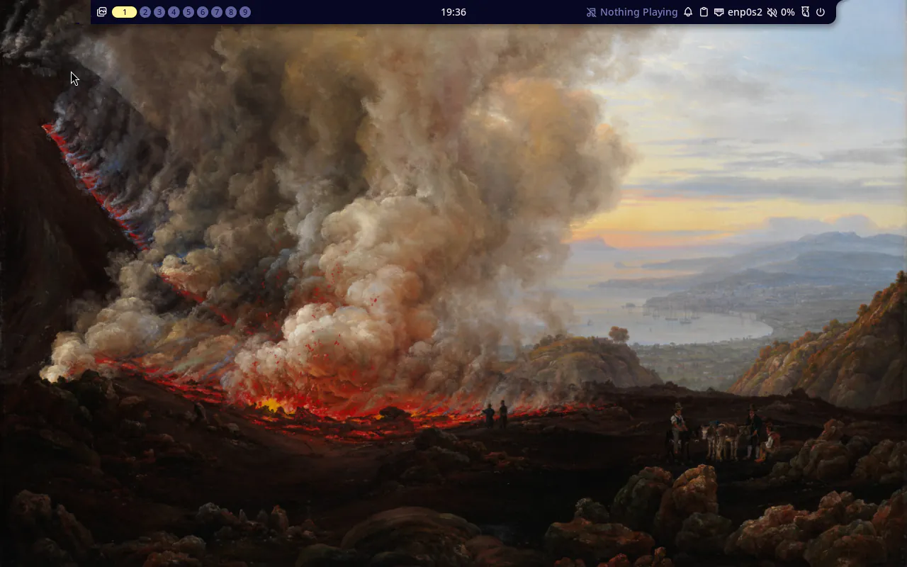
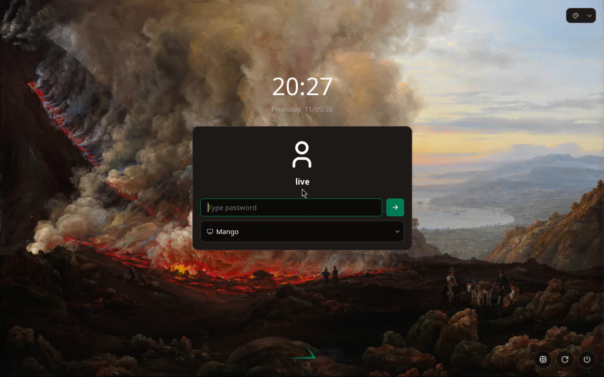

## Goal

`branding/branding.env` is the one place that names the product, its ID, URLs and accent colour, and `stackific-release` renders os-release and the logo icon from it. The Arch live ISO boots to MangoWM showing Dahl's "An Eruption of Vesuvius" behind Noctalia's bar with no setup wizard, `fastfetch` prints our logo in emerald, and Noctalia's wallpaper picker browses the ten shipped paintings.

## Context

Task 004 gave the image its identity from a committed os-release and a committed emerald copy of the logo, so the accent sat in two files and the name in one. This step adds the branding file those render from, the ten wallpapers with their credits, the text logo for fastfetch, a third Arch package for the artwork, and Noctalia defaults in `stackific-desktop`.

## Expectations

Must:

- `just arch packages` exits 0 and leaves `stackific-release-0.1.0-2-any.pkg.tar.zst`, `stackific-desktop-0.2.0-1-any.pkg.tar.zst` and `stackific-artwork-0.1.0-1-any.pkg.tar.zst` in `.build/arch/repo/`.
- `bsdtar -xOf` of `etc/os-release` from the `stackific-release` package prints `branding/os-release`'s ten lines from Context, unchanged, followed by `ID_LIKE=arch` and `BUILD_ID=rolling`. The package's `usr/share/icons/hicolor/scalable/apps/stackific.svg` has sha256 `1644ae7c18a55a86489b80b79ae301b8645f333b25da7684c0b93d21f9ff4dde`.
- `bsdtar -tf` on `stackific-artwork` lists the ten JPEGs under `usr/share/backgrounds/stackific/`, plus `usr/share/licenses/stackific-artwork/wallpapers.toml`, `usr/share/stackific/logo.txt` and `etc/xdg/fastfetch/config.jsonc`. That config contains `"1": "#007a55"` and no `${`.
- `bsdtar -xOf` of `.PKGINFO` from `stackific-artwork` prints `depend = fastfetch`, so installing the package installs fastfetch.
- `bsdtar -tf` on `stackific-desktop` lists `usr/share/stackific/noctalia.toml`, `etc/skel/.config/noctalia/00-stackific.toml`, `usr/share/stackific/greeter.toml` and `usr/lib/tmpfiles.d/stackific-greeter.conf`, plus the files from task 002.
- Changing `ACCENT` in `branding/branding.env` alone changes the accent in the rendered os-release (`ANSI_COLOR`), the icon fill and the fastfetch config. Proved once during /s-build with a throwaway value, then reverted.
- `just arch iso` exits 0 and its last line prints the ISO size in MiB. The manifest lists `stackific-artwork 0.1.0-1`, `stackific-desktop 0.2.0-1`, `stackific-release 0.1.0-2` and `fastfetch 2.70.0-1`.
- `just arch test` passes: every check from tasks 001, 002 and 004, plus the new ones under Tests.
- On an aarch64 host (the Mac runner VM), `just arch iso` and `just arch test` pass, and the aarch64 manifest lists `stackific-release`, `stackific-artwork` and `fastfetch`.
- `.build/arch/x86_64/screen.png` shows Dahl's "An Eruption of Vesuvius" behind Noctalia's bar, and no setup wizard. `.build/arch/x86_64/greeter.png` shows noctalia-greeter over the same painting with our emerald accent, and our green-on-transparent logo where Noctalia's was.
- `just lefthook all` passes (hygiene, shellcheck on the PKGBUILDs, `just dev check`, site checks).

Must not:

- touch files outside the Changes list, or any Fedora file (`fedora/`, `tests/vm/fedora-x86_64.sh`);
- change a file owned by `noctalia`, `fastfetch` or `mangowm`, or set `NOCTALIA_CONFIG_HOME` or `XDG_CONFIG_DIRS`;
- leave `#007a55` or `Stackific OS` hard-coded in a file a package renders. It may appear only in `branding/branding.env`, and in docs and tests that check the result;
- add a dependency this task does not name (the new ones are `gettext` as a makedepend, and `fastfetch` as a dependency of `stackific-artwork`).

## Prompt

```text title="Prompt" wrap
Give Stackific OS one branding file that every branded file renders from: the product name, the ID, the URLs and the accent colour. Make it a shell KEY="value" file, branding/branding.env, and have our package builds render base-neutral *.in templates from it with envsubst, so the os-release and the coloured logo icon come from it instead of from hard-coded copies. Commit the ten public-domain paintings as the wallpaper set, with their credits in branding/wallpapers.toml, and the block-character text logo for fastfetch. Ship them in a new Arch package, stackific-artwork: the wallpapers under /usr/share/backgrounds/stackific/ and a system-wide fastfetch config that shows our logo in the accent colour. Ship Noctalia defaults in stackific-desktop that point its wallpaper folder at the shipped set, make Johan Christian Dahl's "An Eruption of Vesuvius" the default wallpaper, and turn Noctalia's setup wizard off everywhere. Replace Noctalia's branding on the login screen with ours: stackific-desktop ships noctalia-greeter defaults with our palette (the accent from the branding file) and the same painting, linked into place by a tmpfiles line that leaves an administrator's own greeter.toml alone, and puts our green-on-transparent logo where Noctalia's was, through the greeter's documented NOCTALIA_GREETER_ASSETS_DIR override: an asset folder of links to stackific-release's icon and the greeter's own fonts, named in a profile.d script that greetd sources before the greeter. All four images are one product: the same branding, messaging, defaults and checks everywhere, differing only where a base forces it; write that into AGENTS.md. Make fastfetch a dependency of stackific-artwork, so installing our branding installs fastfetch with our logo, on the live ISO and on installed systems. The live ISO installs the new package. The Arch Linux ARM aarch64 console image installs our branding too (stackific-release and stackific-artwork, so fastfetch with our logo), with matching boot-test checks. Extend the boot test to prove the wallpapers, the fastfetch logo and the Noctalia defaults, take a screenshot of the desktop, and report the ISO size against the 2 GiB target. Fedora's RPMs of the same files are task 007.
```

## Outcome

`branding/branding.env` holds the name, ID, four URLs and the accent. `stackific-release` and `stackific-artwork` source it in `build()` and render `branding/os-release.in` and `branding/fastfetch.jsonc.in` with `envsubst` and an explicit key list. `ANSI_COLOR` is derived from the accent with one `printf`, and the icon is `branding/logo.svg` with `currentColor` swapped for the accent. Both come out byte for byte the same as task 004's committed files, so `branding/os-release` and `branding/logo-color.svg` are gone.

`stackific-artwork` depends on `fastfetch`, so installing our branding installs it. It installs the ten paintings to `/usr/share/backgrounds/stackific/`, their credits as its licence file, the text logo to `/usr/share/stackific/logo.txt`, and `/etc/xdg/fastfetch/config.jsonc`, which fastfetch reads when the user has no config of their own. `stackific-desktop` 0.2.0 adds Noctalia's defaults as `/usr/share/stackific/noctalia.toml` (wizard off, the wallpaper folder, Vesuvius as the default) and `/etc/skel/.config/noctalia/00-stackific.toml`, which only includes them. Noctalia reads config only from `~/.config/noctalia/`, so the include is how package updates reach every user, and the user's own files and UI choices still win. mkarchiso copies `/etc/skel` into `/home/live`, so the live user starts on the painting with no wizard.

noctalia-greeter shows our look instead of Noctalia's. `stackific-desktop` renders `desktop/noctalia/stackific-greeter.toml.in` with the accent into `/usr/share/stackific/greeter.toml`: Noctalia's logo hidden, a dark palette in our emerald, and the same painting. A tmpfiles `L` line links `/var/lib/noctalia-greeter/greeter.toml` to it only when that file is missing, so an administrator's own config wins. The greeter has no key for another logo, so `stackific-desktop` gives it another asset folder through its documented `NOCTALIA_GREETER_ASSETS_DIR` override, set in `/etc/profile.d/stackific-greeter.sh`, which greetd sources before the greeter. That folder holds two links: `noctalia.svg` to `stackific-release`'s emerald icon, and `fonts` to the greeter's own fonts. Our green-on-transparent logo then sits where Noctalia's was, and no package file changes.

### Screenshots



_The live desktop on first boot: our default wallpaper, and no setup wizard._



_The login screen after a logout: our palette, painting and logo._

## Review

- Round 1 found nothing. It checked the renders against task 004's files, the package listings, the throwaway accent, the packaging recipe that stages sources by name, and Noctalia's include and merge order against its source.
- Round 2, the operator's follow-up (fastfetch installed with our branding, and the branding on the aarch64 image), found nothing. It checked Arch Linux ARM's fastfetch, gettext and os-release owners against its repo databases.
- Round 3, the operator's follow-up (our branding on the greeter, and one product across all four images in AGENTS.md), found nothing. It checked noctalia-greeter 1.7.0's config keys and precedence, that nothing in the image writes `greeter.toml`, and the tmpfiles `L` line against an existing file.
- Round 4, the operator's follow-up (our green-on-transparent logo on the greeter instead of none), found nothing. It checked the greeter's asset override against its source and both bases' packages.

## Manual changes

None.

## Result

`stackific-release 0.1.0-2`, `stackific-desktop 0.2.0-1` and the new `stackific-artwork 0.1.0-1` are in the local repo and in the Arch live ISO, which gets `fastfetch 2.70.0-1` through `stackific-artwork`.

- `just arch packages` exits 0. os-release is the same ten lines as before plus `ID_LIKE=arch` and `BUILD_ID=rolling`, and the icon's sha256 is `1644ae7c…`, as in task 004. `stackific-artwork` lists the ten paintings, the credits, `logo.txt` and the fastfetch config with `"1": "#007a55"`. `stackific-desktop` adds `usr/share/stackific/noctalia.toml` and `etc/skel/.config/noctalia/00-stackific.toml`.
- With `ACCENT="#123456"` in a scratch copy, the rendered files show `38;2;18;52;86`, `fill="#123456"` and `"1": "#123456"`.
- `just arch iso` exits 0: 1538 MiB against the 2048 MiB target, 41 MiB more than task 004's 1497 MiB, the size of the paintings.
- `just arch test` prints `PASS`, with `ok` for every earlier check and the new ones: the greeter's `greeter.toml` link with our primary colour, the asset folder's link to our icon, the greeter's `NOCTALIA_GREETER_ASSETS_DIR`, ten wallpapers, `live`'s include matching `/etc/skel`, `noctalia config export merged` showing the wizard off, the folder and the default, and fastfetch's last logo line in `38;2;0;122;85`.
- `just lefthook all` passes.
- The aarch64 image installs `stackific-release` and `stackific-artwork` too, and `tests/vm/arch-aarch64.sh` checks them. It was not built here, because only an aarch64 host builds it: run `just arch iso` and `just arch test` on the Mac runner VM, or let the `images` workflow run them after the merge.

Docs added or changed: `docs/arch-iso.md` (the branding file, the three packages, Live session, Boot test, aarch64), the new user page `site/src/content/docs/user/wallpapers.md` with the credits, and `AGENTS.md`.

## Deviations

- The task's `ACCENT` test said to run `just arch packages` with a throwaway accent. That cannot work, because the PKGBUILDs pin `branding.env`'s sha256 and makepkg refuses the edited file. The test now builds the two packages from a scratch copy of `branding/` with `makepkg --skipchecksums`, leaving the working tree unchanged. The task file is updated.
- `docs/arch-iso.md` also says how to give a user created before the package was installed the `/etc/skel` include.
