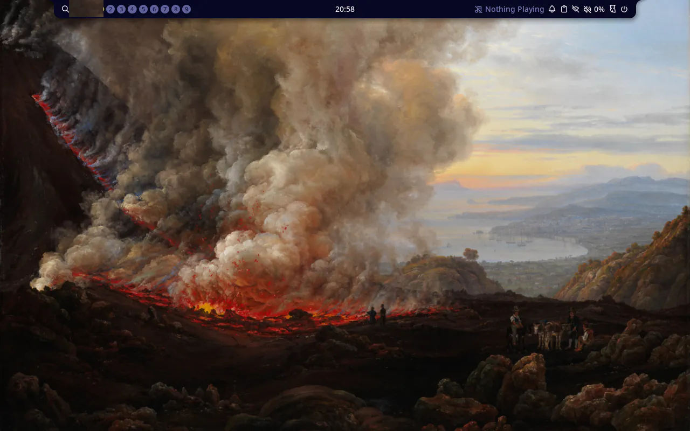
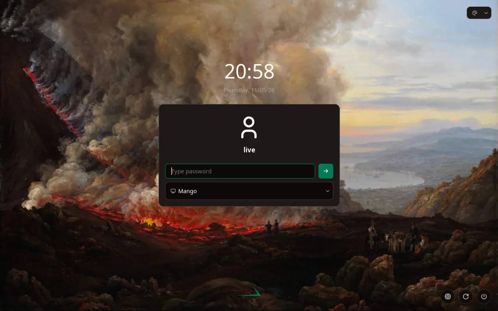

## Goal

In the Mac's runner VM, `just arch iso` builds an aarch64 live ISO that identifies as Stackific OS and boots into MangoWM with Noctalia as `live`, with Plasma available from noctalia-greeter. `just arch test` runs the same Arch checks there as on x86_64.

## Context

Before this step, the aarch64 image from task 005 booted to a console with task 006's branding, while x86_64 had task 002's desktop with 006's wallpapers, Noctalia defaults and greeter look, and task 007's fastfetch fix. This step gives aarch64 the same package list, apart from the kernel, the microcode and the Arch Linux ARM keyring, and makes both Arch images pass one shared check file.

## Expectations

Must:

- In the runner VM, `just arch iso` exits 0, writes `.build/arch/aarch64/stackific-0.0.0-dev-arch-aarch64.iso` and its `.packages.txt`, and its last line prints the ISO size in MiB against 2048 MiB. The ISO is 2048 MiB or less.
- The manifest lists `stackific-desktop`, `stackific-release`, `stackific-artwork`, `mangowm`, `noctalia`, `noctalia-greeter`, `greetd`, `plasma-desktop` and `linux-aarch64`, and lists neither `amd-ucode` nor `intel-ucode`.
- The mirror rule holds: `diff <(grep -vx archlinuxarm-keyring arch/iso/packages.aarch64 | sed 's/^linux-aarch64$/linux/') <(grep -vxE 'amd-ucode|intel-ucode' arch/iso/packages.x86_64)` prints nothing.
- In the runner VM, `just arch test` exits 0, and every check of `tests/vm/arch.sh` passes on aarch64: identity, the desktop session, wallpapers, Noctalia's merged defaults, the greeter's config, logo and environment, fastfetch's logo, and its `OS: Stackific OS` line.
- `just arch test` leaves `.build/arch/aarch64/screen.png` and `greeter.png`:
  - `screen.png` shows MangoWM with Noctalia's bar on "An Eruption of Vesuvius", with no welcome dialog;
  - `greeter.png` shows noctalia-greeter in our palette on the same painting, with the Stackific logo.
- On the operator's PC, `just arch iso` and `just arch test` pass on this branch with `tests/vm/arch.sh`.
- After the merge, the `images` run on `main` passes every job, and the test release `v0.0.0-pr.<n>` holds the aarch64 desktop ISO.
- `just lefthook all` passes.
- The task report states the aarch64 ISO size in MiB against the 2048 MiB target, and the versions the manifest took for the packages named above.

Must not:

- change `arch/iso/packages.x86_64`, any check in the moved check file, or any of 006's defaults;
- patch or replace MangoWM's, Noctalia's or noctalia-greeter's packaged files;
- pin ALARM packages, cross-build, or use qemu-user;
- add `NOPASSWD` or a polkit rule;
- touch files outside the Changes list (the review record and prompt-trail entry from /s-build excepted), or add a dependency this task does not name.

## Prompt

```text title="Prompt" wrap
Turn the Arch Linux ARM aarch64 console live ISO from task 005 into the same desktop live ISO that x86_64 has after tasks 002, 004 and 006: one product, as AGENTS.md asks. It boots straight into MangoWM with Noctalia, with no first-run welcome. greetd logs the user live in automatically, and noctalia-greeter, with our logo, palette and wallpaper, is the login screen after a logout, with KDE Plasma as the second session. Take every desktop package unmodified from Arch Linux ARM's live repos, and reuse our stackific-desktop, stackific-release and stackific-artwork packages, which are arch=any. The aarch64 package list mirrors the x86_64 one; only the kernel, the microcode and the ALARM keyring differ. Both Arch images then pass the same checks, so the boot test runs one Arch check file on both, with a screenshot of the desktop and of the greeter. Report the ISO size against the 2 GiB target. Build and test it in the Mac's runner VM.
```

## Outcome

`arch/iso/packages.aarch64` now mirrors `packages.x86_64` line for line: `linux-aarch64` for `linux`, no microcode, and `archlinuxarm-keyring` after `linux-firmware`. The aarch64 image therefore takes the same desktop from Arch Linux ARM's live repos, with our three packages, `stackific-desktop`, `stackific-release` and `stackific-artwork`, which are `arch=('any')`. With them come task 006's look and defaults, unchanged:

- Dahl's "An Eruption of Vesuvius" as the wallpaper;
- no Noctalia first-run welcome;
- noctalia-greeter in our palette, with the Stackific logo;
- fastfetch with our logo and, since task 007, its full list of default modules.

The image is 1332 MiB with 658 packages.

Both Arch images pass the same checks, so `tests/vm/arch-x86_64.sh` became `tests/vm/arch.sh`, unchanged, and `just arch test` passes it on both architectures. The aarch64 console checks from task 005 are gone; the identity, wallpaper and fastfetch checks that tasks 006 and 007 added for aarch64 were already in the x86_64 file. Every one of them passes on aarch64, where MangoWM, Noctalia and the greeter draw on QEMU's `virtio-gpu-pci` with Mesa's software renderer under nested KVM.

### Screenshots



_The aarch64 live desktop: MangoWM with Noctalia on the default wallpaper, Dahl's "An Eruption of Vesuvius", with no first-run welcome. It is rendered in software on the Mac's runner VM._



_After a logout, noctalia-greeter shows our palette, with the emerald accent on dark taupe, over the same painting, and the Stackific logo at the bottom._

## Review

- Round 1 found one issue: the two package lists must match, but only a hand-run `diff` checks it, so a package added to one list could miss the other image. A pre-commit check would catch it, but it would touch files outside the task's Changes list, and AGENTS.md makes CI checks chore work. So it was rejected here and left as a follow-up chore.
- Round 2 found nothing new.
- Round 3 reviewed two desktop defaults this task had added on the operator's request: no Noctalia welcome, and our logo on the greeter. It found nothing. Task 006 then merged with both, for every Arch image, so this task dropped its own versions.
- Round 4 reviewed the task rebuilt on `main` after 006, now only the mirror, the shared check file, the recipe, the docs and the naming rule. It found nothing.
- Round 5 reviewed the update to `main` after task 007, whose fastfetch fix added a check to both Arch check files. The shared file carries it, and it found nothing.
- Round 6 reviewed the update to `main` after task 008, which changed no Arch build or test file, and the Arch docs' Plasma login step brought in line with 008's finding. It found nothing.

## Manual changes

The build ran on the Mac's runner VM, driven from the Mac's checkout: the tree went into the VM's clone as one tar, and the recipes ran there with `limactl shell`. Still to do by hand:

- Before the merge, on the PC: `just arch iso` and `just arch test` must pass with `tests/vm/arch.sh`.
- After the merge: the `images` run on `main` must pass every job, and the test release must hold the aarch64 desktop ISO.

## Result

In the Mac's runner VM (Fedora 44, Apple M4 Pro, nested KVM):

- `just arch iso` exits 0 and prints `1332 MiB (target 2048 MiB)`.
- The manifest has 658 packages, including:
  - our packages: `stackific-desktop 0.2.0-1`, `stackific-release 0.1.0-2` and `stackific-artwork 0.1.0-2`;
  - the desktop: `mangowm 0.18.4-1`, `noctalia 5.4.1-1`, `noctalia-greeter 1.7.0-1`, `greetd 0.10.3-2`, `plasma-desktop 6.8.2-1`, `rofi 1.7.5-3` and `fastfetch 2.70.0-1`;
  - `linux-aarch64 7.3.1-2`.

  There is no `amd-ucode` or `intel-ucode`.

- The mirror rule's `diff` prints nothing.
- `just arch test` prints `PASS`, with every check of `tests/vm/arch.sh`:
  - identity;
  - the desktop session and the ten wallpapers;
  - Noctalia's merged defaults for `live`;
  - the greeter's config, logo and environment;
  - fastfetch's logo in the accent, and its `OS: Stackific OS` line.

  It leaves `screen.png`, `greeter.png` and `serial.log`.

Docs: `docs/arch-iso.md` says the aarch64 image is the same desktop as x86_64, with its package list mirroring x86_64's and Arch Linux ARM's older rofi. Both architectures source `tests/vm/arch.sh`, and the manual Plasma login types any character as the password, as on Fedora, because noctalia-greeter refuses an empty field. `AGENTS.md` widens the check-file naming rule to `tests/vm/<base>.sh`. No user docs: nothing is released yet.

## Deviations

The task file was rewritten once during the build. The operator had asked to add no Noctalia welcome and our greeter branding to this task. Task 006 then merged with both for every Arch image, so the task now starts from `main` after 006 and takes them through the mirror instead of adding its own. Task 007 then merged a fastfetch fix with a new check in both Arch check files; the task now starts after 007, and the shared file carries that check. Task 008 merged next with no Arch build or test change, so the build above stands; its finding that noctalia-greeter refuses an empty password field corrected the Arch docs' manual Plasma login.
