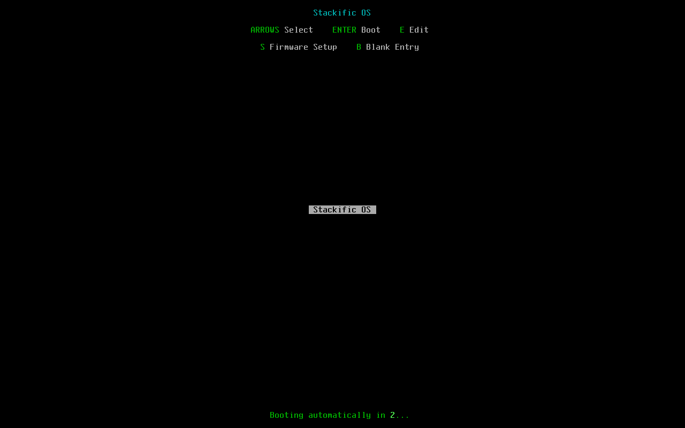
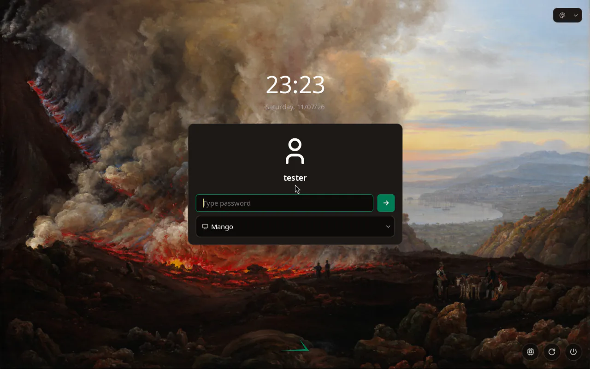
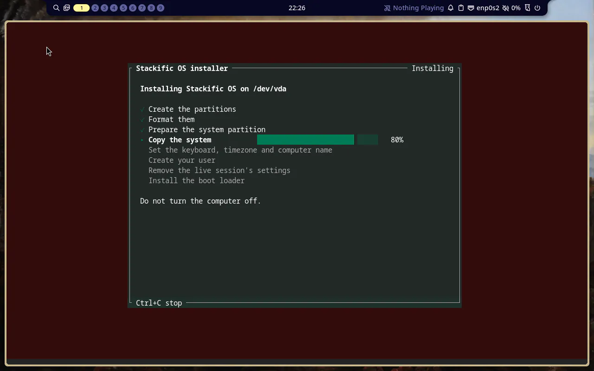
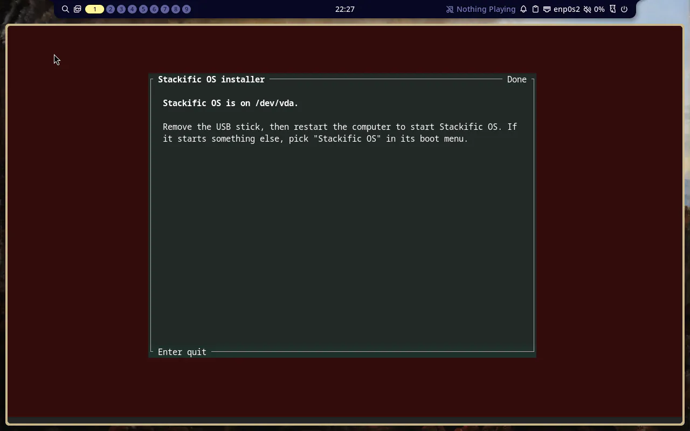

## Goal

After an install from the Arch x86_64 live ISO, in either mode, the computer starts Stackific OS from the drive: the firmware's "Stackific OS" entry starts Limine, Limine's menu starts the kernel, and the system reaches its login screen. `just arch test-install` proves it by booting the installed disk image.

## Context

Task 012's installer wrote a complete system, but the drive did not start: mkarchiso leaves `/boot` empty, and nothing put a boot loader on the ESP. This step adds the installer's eighth step, Limine's program, its menu and the firmware entry, a small package that keeps Limine current, and a second boot in the install test.

## Expectations

Must:

- `just installer test` and `just installer lint` pass; unit tests cover `limine.conf`'s text, the stale-entry rule on the fixture listing (only the entry on a missing partition is deleted), the create command, Arch's initramfs command, and step 8's place after the live-state step.
- `just installer demo` runs to Done and shows eight steps.
- `just arch packages` builds `stackific-boot`; `pacman -Qlp` of it lists exactly `/usr/share/libalpm/hooks/stackific-limine.hook` (plus its folders).
- `just arch iso` builds and prints the ISO size (task 012: 1543 MiB; target 2048 MiB); its manifest lists `stackific-boot`, `limine 12.9.6-1`, `efibootmgr 18-4` and `arch-install-scripts 32-1`. `just arch test` passes unchanged.
- `just arch test-install` passes, and in its second boot, from the disk image alone:
  - serial.log shows OVMF starting `Boot#### "Stackific OS"`, and `limine.png` shows Limine's menu with "Stackific OS" as its header and entry;
  - the system reaches `running`, and greetd's login screen shows on the installed system;
  - `efibootmgr` shows `BootCurrent` labelled "Stackific OS", first in `BootOrder`, and exactly one entry labelled "Stackific OS" after the erase and the free-space install on the same disk;
  - `/proc/cmdline` has `root=UUID=<UUID of />`, `rootflags=subvol=/@` and `rw`; `findmnt` shows `/` as btrfs with `subvol=/@` and `/boot` as vfat on the ESP; `btrfs subvolume get-default /` prints `ID 5 (FS_TREE)`;
  - `/boot` holds `vmlinuz-linux`, `initramfs-linux.img`, `limine.conf`, `EFI/limine/BOOTX64.EFI` and `EFI/BOOT/BOOTX64.EFI`, and no `*-fallback.img` and no `EFI/Linux/`; both EFI copies equal `/usr/share/limine/BOOTX64.EFI`; the initramfs has no `archiso` hook; `uname -r` names the one folder under `/usr/lib/modules/`;
  - after both EFI copies are emptied, `pacman -U` of the same `limine` package restores them, and the firmware entries are unchanged;
  - `stackific-boot`, `limine` and `efibootmgr` are installed; `stackific-installer` and `arch-install-scripts` are not; the hostname is `stackific-test`, the timezone `Europe/Berlin`, `localectl` shows the X11 layout and console keymap `de`, and `tester` is in `wheel`;
  - after the login screen's screenshot, the test logs `tester` in through greetd's `[initial_session]` (edited from the test shell, as the live test does): in MangoWM, `mmsg get keyboardlayout` as `tester` prints the German layout; in Plasma, `getLayoutsList` as `tester` names `de` first. If either shows `us`, the build fixes the installer's keyboard files and says so in the prompt trail.
- `just arch test-install`'s first boot still passes every task 012 check, and `installed_checks` finds the boot files and `limine.conf` with that install's root UUID for both the erase and the free-space install.
- The Done screen, `release/notes.md`, `site/src/content/docs/user/installation.md` and `docs/installer.md` no longer say the drive cannot start: `git grep -n -i -e "cannot start" -e "does not start" -e "spare drive" -- release site/src/content/docs/user docs installer/src` prints nothing.
- `just lefthook all` passes (shellcheck on the new and changed scripts and the PKGBUILD, `just dev check`, the site's checks).

Must not:

- use limine-mkinitcpio-hook, limine-entry-tool, limine-snapper-sync or any other AUR package;
- build a fallback initramfs or a unified kernel image, or enroll a config hash;
- write to any ESP but ours, or set the btrfs default subvolume;
- write NVRAM anywhere but in the installer's step 8, or change the order of the entries it did not create;
- add a boot entry or Limine to the aarch64 image (task 018) or touch Fedora (task 014);
- touch files outside the Changes list, or add a dependency this task does not name.

## Prompt

```text title="Prompt" wrap
Make the drive the installer writes start on its own, on the Arch x86_64 image. Limine boots it from our own 4 GiB FAT32 EFI System Partition, never another OS's. The kernel and its initramfs reach the ESP through Arch's own mkinitcpio hooks, with no fallback initramfs and no unified kernel image, and Limine's entry finds root through rootflags=subvol=/@. The firmware's boot entry is labelled with the product name, "Stackific OS", and comes first in the boot order; the installer keeps every other entry in its order and writes NVRAM only at install. The install test boots the installed system and checks it. Change the installer's Done screen, the user docs and the release notes, which say today that the drive cannot start yet. On the booted system, check the two things task 012 left open (whether KDE Plasma takes its first keyboard layout from systemd-localed's X11 setting, and whether MangoWM reads the user's ~/.config/mango/config.conf rather than /etc/mango/config.toml), and fix what the check finds.
```

## Outcome

The installer's new eighth step, "Install the boot loader", runs after the live session's settings are gone, so archiso's mkinitcpio drop-in no longer applies:

- **Kernel and initramfs:** Arch's own pacman-hook script, `/usr/share/libalpm/scripts/mkinitcpio install`, runs in the target through `arch-chroot` with the kernel on stdin, as pacman runs it on a kernel install. It writes `/boot/vmlinuz-linux` and `/boot/initramfs-linux.img` on our ESP with mkinitcpio 42.2's default preset (no fallback image) and default hooks (systemd, with the CPU's microcode prepended). mkinitcpio's pacman hooks keep both files current on updates, so nothing of ours runs on a kernel update. This part sits behind the installer's `Base` trait; the rest of the step is shared.
- **Limine:** its program is copied to `\EFI\limine\BOOTX64.EFI` and to the fallback path `\EFI\BOOT\BOOTX64.EFI`, both on our ESP only. One `limine.conf` at the ESP's root serves both: `timeout: 3`, the menu's header and its one entry named after os-release's `NAME`, and `cmdline: root=UUID=<system partition> rootflags=subvol=/@ rw`.
- **Firmware entry:** last, so an earlier failure leaves none. The installer deletes any entry that starts our loader from a partition this computer no longer has (a reinstall over an earlier Stackific OS), then creates "Stackific OS" with `efibootmgr --create`, which puts it first and keeps every other entry after it. Nothing writes NVRAM at boot or on updates.
- **`stackific-boot`:** a new Arch package that keeps `limine` and `efibootmgr` on installed systems and ships one pacman hook: after an upgrade or reinstall of `limine`, it copies Limine's program over both ESP copies. The `limine` package ships no hook of its own.
- **Done screen:** it now says to remove the USB stick and restart, and to pick "Stackific OS" in the boot menu if the computer starts something else. The user docs and release notes no longer say the drive cannot start.

`just arch test-install` now boots twice. The first boot installs and checks as task 012 did, plus each install's ESP files and that the Windows-like ESP stays empty. The second boot starts the installed disk alone with the firmware variables the first left behind. OVMF's serial log shows it starting `Boot0009 "Stackific OS"`, and `limine.png` catches Limine's menu during its countdown. `tests/vm/installed.sh` then checks the firmware entries, the kernel command line, the mounts, the ESP, the initramfs, the packages, the system settings and the login screen. It empties both copies of Limine's program and reinstalls the pinned `limine` package (copied onto the ESP with `mcopy`), which restores them. It also logs `tester` into MangoWM and Plasma. Both open with the German layout the installer set (`{"layout":"German"}` from `mmsg`, `de` first from KWin), which settles the two questions task 012 left open: MangoWM reads the user's `config.conf`, and Plasma takes localed's X11 layout.

### Screenshots



_The installed disk's boot menu: our name in the header and the entry, with a three-second countdown._



_The installed system's login screen after Limine started it, with the user the installer made and the clock in Europe/Berlin._



_The new eighth step._



_Done no longer says the drive cannot start._

## Review

- **Round 1** found two test and build weaknesses, both fixed. The initramfs check counted archiso and systemd lines together, so an archiso-built initramfs could pass; it is now two checks. `just arch packages` copied whole package folders, which stops on folders left by a local makepkg run; the package's folder now joins the by-name source search.
- **Round 2** covered the fixes and the setup changes you asked for during the build. It found that `just serena check` sent anyone with a `serena` of their own into a loop; it now names that file and says to remove it.
- **Round 3** found nothing.

## Manual changes

None.

## Result

- `just installer test` passes 55 tests (the stale-entry rule on a real OVMF listing, `limine.conf`'s text, the boot step's order and commands, the eight-step and Done snapshots); `just installer lint` passes.
- `just arch packages` builds `stackific-boot` 0.1.0-1 with exactly its hook. `just arch iso` makes a 1545 MiB ISO (target 2048 MiB) whose manifest lists `stackific-boot 0.1.0-1`, `limine 12.9.6-1`, `efibootmgr 18-4` and `arch-install-scripts 32-1`. `just arch test` passes unchanged.
- `just arch test-install` prints `PASS` for both boots. On the installed disk, OVMF started `Boot0009 "Stackific OS"`, the one entry with that label, first in `BootOrder`. `/proc/cmdline` holds `root=UUID=<root> rootflags=subvol=/@ rw`, the btrfs default subvolume is ID 5, and the ESP has no fallback image and no unified kernel image. The hook restored Limine's program after a reinstall, and MangoWM and Plasma started with the German layout.
- A fresh Fedora 45 container with only `docs/setup.md`'s prerequisites ran `just setup`; every tool reported `ok` except `podman`, which image builds need. Serena answered the MCP handshake through `.mcp.json`'s command.
- Docs: `docs/installer.md` (the boot step, `stackific-boot`, the second boot, Later), `docs/arch-iso.md` (the package staging, `stackific-boot`, the install test), `docs/setup.md` (restarting the runner), `site/src/content/docs/user/installation.md` (Install it, Limits) and `release/notes.md`.

## Deviations

- Folded into this task's change at the operator's request, with no separate chore commit:
  - `docs/setup.md` says how to restart the PC's runner service and read its log.
  - `just runner vm` installs `openssl3-libs` in the Mac's runner VM. Fedora 45's own OpenSSL is 4 (`libssl.so.4` only), and the runner's .NET loads only `libssl.so.3` or older, so `just runner setup` failed with "No usable version of libssl was found".
  - Serena gets a launcher on PATH, and `.mcp.json` runs `serena start-mcp-server --context claude-code --project-from-cwd` directly, no longer through `just serena mcp`. A justfile that does not parse, or a worktree without `.tools/`, kept Serena from starting; `just serena check` (in `just doctor`) now fails without the launcher. `AGENTS.md` says so.
  - lefthook gets a launcher on PATH, and `just lefthook check` fails without it. The shared git hooks named the lefthook binary of the 012 worktree, which was removed after its merge, so every commit since skipped every check; the hooks fall back to `lefthook` on PATH. `AGENTS.md` says to run `just setup` and `just lefthook hooks` in the main checkout only.
  - Task 012's Done box is ticked.
- The task's drawing of the Done screen was updated to the real wrap at 75 columns.
- `installer/src/system.rs` was not changed: the keyboard checks found the layout right in both desktops.
