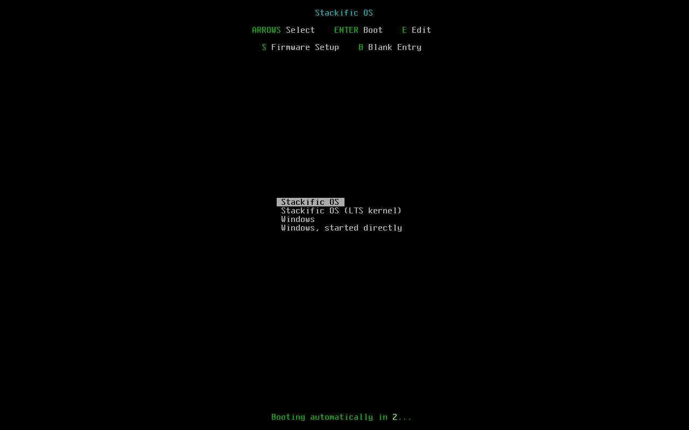

## Goal

The Arch x86_64 live ISO and every install from it carry `linux` and `linux-lts` with NVIDIA's open modules for both. A boot-time generator loads nouveau instead on older NVIDIA cards, waits for the GPU driver before the login screen, and gives MangoWM lighter effects where nouveau draws the desktop. Installs get a Limine entry for the LTS kernel.

## Context

The image had no NVIDIA driver and one kernel. Arch's `nvidia-utils` blacklists nouveau, and NVIDIA's open module drives only Turing (GTX 16, RTX 20) and newer, so simply adding the packages would leave older cards with no driver. This step adds the packages and the small piece of glue that picks the driver, from a committed copy of NVIDIA's own legacy device list.

## Expectations

Must:

- `just arch packages` builds `stackific-hardware`; `just arch iso` builds the x86_64 ISO and prints its size, at most 2048 MiB. If it is larger, stop and report the sizes to the operator before going on.
- `just hardware test` passes: for recorded PCI sets (Turing desktop `10de:1e04`; Pascal desktop `10de:1b80`; MX150 `10de:1d10` with Intel `8086:9b41`; AMD `1002:73bf` alone; Intel alone; Turing `10de:1f99` with AMD; a Pascal plus a Turing card; an NVIDIA HDMI audio function `10de:10f0` class `0x040300` alone; no PCI display device) the generator writes exactly the expected files: the modprobe redirect only for the pre-Turing-only sets, the MangoWM link only for the Pascal desktop, the greetd drop-in for every set with an NVIDIA display controller.
- On the live ISO in QEMU (`just arch test`): `pacman -Q` lists `linux-lts`, `nvidia-open`, `nvidia-open-lts`, `nvidia-utils` and `stackific-hardware`; `modinfo -F vermagic` of `nvidia` for `linux` and for `linux-lts` starts with each kernel's version; the generator ran and wrote nothing (no `/run/modprobe.d/nvidia-utils.conf`, no `/run/stackific/mango-gpu.conf`, no greetd drop-in); the session checks still pass; the ISO's `arch/boot/x86_64/` holds no `linux-lts` file.
- On the installed system (`just arch test-install`): `/boot` holds `vmlinuz-linux`, `initramfs-linux.img`, `vmlinuz-linux-lts`, `initramfs-linux-lts.img` and no fallback image; `limine.conf` has the entries `/Stackific OS` and `/Stackific OS (LTS kernel)`; neither initramfs contains `nvidia` or `nouveau` modules (`lsinitcpio`); the user's MangoWM config has the `source_optional` line; every existing install check passes.
- The installer's unit tests pass (`just installer test`), with tests for the two Limine entries and the user config.
- Every existing boot and install test passes on Arch x86_64.

Must not:

- add `nvidia-open-dkms`, a compiler or headers to the image, or chwd;
- put NVIDIA or nouveau modules in any initramfs;
- change MangoWM's own `/etc/mango/config.conf` or the Fedora and aarch64 images' package lists;
- add a boot menu entry to the live ISO;
- touch files outside the Changes list.

## Prompt

```text title="Prompt" wrap
Make NVIDIA graphics work on the Arch x86_64 image, live and installed. Ship linux-lts as a fallback kernel next to linux, with Arch's prebuilt nvidia-open and nvidia-open-lts, so no compiler and no network are needed; give the installed system a second Limine entry for the LTS kernel. Turing and newer cards (GTX 16, RTX 20 and later) run NVIDIA's open modules; older cards run nouveau, decided from a committed copy of NVIDIA's own legacy-branch device list read through sysfs. Pick the driver at every boot with a small systemd generator, so the live session starts on any GPU without asking, and an installed system follows a GPU swap. Keep NVIDIA and nouveau modules out of the initramfs: mkinitcpio's autodetect resolves an NVIDIA card to nouveau even when it is blacklisted, so leave the kms hook out of installed x86_64 systems. Where an older NVIDIA card running nouveau draws the desktop, MangoWM starts with lighter effects through an include file (source_optional), without touching MangoWM's own config. chwd, CachyOS's hardware-detection tool, is the one CachyOS tool we accept; use it only if the design needs it. Report the ISO size and keep it within 2 GiB: keep linux-lts's kernel and initramfs off the live medium with a live-only pacman hook, and compress the live initramfs with xz as archiso's releng profile does.
```

## Outcome

- **The packages.** `arch/iso/packages.x86_64` adds `linux-lts`, `nvidia-open`, `nvidia-open-lts`, `nvidia-utils` and our new `stackific-hardware`. All come from the pinned archive date, so each module matches its kernel. The installer copies the live root, so every install has them too, on any hardware.
- **The pick.** `stackific-gpu-generator` runs at every boot, before udev loads GPU modules, and reads the display controllers from sysfs. When all NVIDIA graphics are in `hardware/nvidia-legacy.ids` (879 IDs from NVIDIA's own tables in `nvidia-utils` 615.78.08), it writes `/run/modprobe.d/nvidia-utils.conf`. That file shadows the package's own and blacklists NVIDIA's modules instead of nouveau, so udev loads nouveau. When such a card is the only GPU, `/run/stackific/mango-gpu.conf` links the low-effects include, which every user's MangoWM config reads with `source_optional=`. Any NVIDIA display makes greetd wait for udev to settle, so the session starts on the loaded driver.
- **The initramfs.** In the builder, `modprobe -qaR` printed `nouveau` for a Pascal card even with `nvidia-utils`' blacklist installed. So mkinitcpio's `autodetect` would put nouveau and its firmware into the initramfs on every NVIDIA machine, and the installer now leaves `kms` out of installed x86_64 systems' hooks. aarch64 keeps it.
- **The LTS kernel.** `Base::kernel_files` lists both kernels; `limine.conf` gets `/Stackific OS` and `/Stackific OS (LTS kernel)`. The live ISO boots `linux` only.
- **Size.** The first build was 2079 MiB, because mkinitcpio's hook script copied `vmlinuz-linux-lts` to the live `/boot` even with an empty preset, and mkarchiso carries every kernel twice. A live-only pacman hook now removes `linux-lts`'s files after mkinitcpio's hook, and the live initramfs is xz-compressed: 2041 MiB.

### Screenshots



_Limine's menu after the install: the LTS kernel is the second entry, before Windows._

## Review

- **Round 1** found nothing in the change itself. It accepted one limit: a machine with both a Pascal and a Turing card leaves the Pascal card without a driver, while the Turing card draws the desktop.
- **Round 2** covered the fix after the first install test, which picked "Windows" in Limine's menu with a fixed number of key presses that the new LTS entry had shifted. The test now finds the entries' place in `limine.conf` and also boots the LTS entry. It found nothing.

## Manual changes

None.

## Result

- `just hardware test`: all ten PCI sets write exactly the expected files.
- `just installer lint` and `just installer test` (66 tests) pass.
- `just arch packages` and `just arch iso` pass: the ISO is 2041 MiB (target 2048 MiB).
- `just arch test` passes, with the new x86_64 checks: the five packages, each `nvidia` module's vermagic matching `linux` 7.2.11 and `linux-lts` 6.18.60, no `linux-lts` file on the medium, and the generator idle on QEMU's std VGA (no redirect, no MangoWM link, no greetd drop-in, neither module loaded).
- `just arch test-install` passes: both kernels and initramfs files on the ESP, both Limine entries, no NVIDIA or nouveau module in either initramfs, the user's `source_optional` line, then a boot through "Stackific OS (LTS kernel)" (`uname -r` ends in `-lts`) before the two Windows entries, which the test now finds by their place in `limine.conf`.
- `just lefthook all` passes.
- Docs: `docs/hardware.md` (new), `docs/arch-iso.md`, `docs/installer.md`, `site/src/content/docs/user/graphics.md` (new), `site/src/content/docs/user/system-requirements.md`, `site/src/content/docs/user/installation.md`, `release/notes.md`, `AGENTS.md`.
- Real NVIDIA hardware cannot be emulated; the task lists the operator's three checks (an RTX PC, a GTX 10 PC, the LTS entry), collected by task 030.

## Deviations

- No chwd: every image and install carries all GPU packages and the generator picks the module, so chwd has nothing to decide for GPUs yet. Task 021 decides it for Broadcom STA and fingerprint readers.
- No "graphics hardware changed" notice and no installer warning for older NVIDIA cards; both are logged in `docs/hardware.md`.
- `kms` is left out of installed x86_64 systems' hooks on every machine, not only on NVIDIA ones: the installer would otherwise need its own detection, and a disk moved to an NVIDIA machine would get nouveau in its initramfs at the next kernel update. AMD and Intel lose early KMS; the passphrase prompt draws on the firmware's framebuffer.
- `lefthook.yml` runs `just hardware test` on `hardware/**`, and `tests/vm/installed.sh` finds Limine's Windows entries by their place in `limine.conf` and boots the LTS entry (neither in the task's Changes list).
- The live medium's `linux-lts` files are removed by a pacman hook, not by an empty preset, and the live initramfs is xz: the task file was updated.
