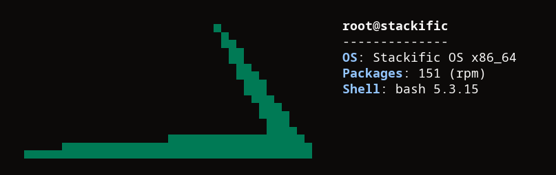

## Goal

Build our three packages for Fedora 45 from the same base-neutral files as the Arch ones, and put them in a local dnf repo the Fedora image can install from.

## Context

Task 006 added the branding file and the Arch artwork package, and task 003 built a console Fedora ISO that still says `Generic`. This step adds the Fedora specs, a mock recipe in the pinned builder, and a `stackific-release` that replaces `generic-release`. The Fedora desktop image that installs them comes next.

## Expectations

Must:

- `just fedora packages` exits 0 and leaves `stackific-release-0.1.0-1.fc45.noarch.rpm`, `stackific-desktop-0.2.0-1.fc45.noarch.rpm`, `stackific-artwork-0.1.0-1.fc45.noarch.rpm` and `repodata/repomd.xml` in `.build/fedora/repo/`, and no `.src.rpm` or logs.
- `bsdtar -tf` on each RPM lists exactly the paths in Context's table (plus the directories), and the Arch package from task 006 lists the same paths, except for the os-release path. Compare `bsdtar -tf` output of the RPM and the `.pkg.tar.zst` with the metadata and directory entries filtered out.
- `bsdtar -xOf` of `./usr/lib/os-release` from `stackific-release` prints the ten lines of task 006's rendered os-release, byte for byte the Arch package's first ten lines, followed by `ID_LIKE=fedora`, `VERSION_ID=45` and `SUPPORT_END=2027-12-08`. The icon has sha256 `1644ae7c18a55a86489b80b79ae301b8645f333b25da7684c0b93d21f9ff4dde`. `/etc/xdg/fastfetch/config.jsonc` from `stackific-artwork` matches the Arch package's file byte for byte.
- `rpm -qp --provides` on `stackific-release` lists `system-release`, `system-release(45)`, `system-release(releasever) = 45` and `generic-release-variant = 45-0.4`. `rpm -qp --requires` lists `generic-release-common`, `distribution-systemd-presets` and `hicolor-icon-theme`. `rpm -qp --conflicts` lists `generic-release`.
- `rpm -qp --configfiles` on `stackific-desktop` lists `/etc/profile.d/stackific-wlroots.sh`, `/etc/profile.d/stackific-greeter.sh` and `/etc/skel/.config/noctalia/00-stackific.toml`. Its rendered `/usr/share/stackific/greeter.toml` is byte-identical to the Arch package's, and its two `greeter-assets` links have the same targets. On `stackific-artwork` it lists `/etc/xdg/fastfetch/config.jsonc`, and `rpm -qp --requires` lists `fastfetch`.
- In a fresh container of the pinned Fedora base, installing `stackific-release` from `.build/fedora/repo/` with `dnf -y install --allowerasing` succeeds. After it:
  - `. /etc/os-release; echo "$ID/$ID_LIKE/$VERSION_ID/$PRETTY_NAME"` prints `stackific/fedora/45/Stackific OS`;
  - `rpm -q generic-release fedora-release-common` reports both not installed, and `rpm -q generic-release-common redhat-systemd-presets` reports both installed;
  - `dnf5 --dump-variables` prints `releasever = 45`, and `dnf repoquery kernel` prints a `.fc45` kernel.
- `just lefthook all` passes.

Must not:

- touch files outside the Changes list (the review record and prompt-trail entry from /s-build excepted), and in particular `fedora/iso/`, `tests/vm/` and `.github/workflows/`;
- copy, patch or edit any file of `desktop/` or `branding/` for Fedora; the specs install the same files and render them with the same lines;
- ship or require `fedora-release*`, `fedora-logos` or `fedora-release-notes`, or provide `system-logos`;
- add a dependency this task does not name (the new ones: `mock` in the builder, `gettext-envsubst` and `systemd-rpm-macros` as BuildRequires, `fastfetch` as a Requires of `stackific-artwork`, and `noctalia-greeter` and `stackific-release` as Requires of `stackific-desktop`, as on Arch).

## Prompt

```text title="Prompt" wrap
Build Fedora 45 RPMs of our three packages, stackific-release, stackific-desktop and stackific-artwork, from the same base-neutral files in desktop/ and branding/ that the Arch PKGBUILDs use. They must install the same files at the same paths, rendered from branding/branding.env with the same envsubst lines. Build them with mock in the pinned Fedora builder container, rootless like every other build. Add `just fedora packages`, which puts them into the local dnf repo .build/fedora/repo/ with createrepo_c metadata, unsigned until release signing. stackific-release replaces generic-release without patches and without fedora-release*: it provides system-release for Fedora 45, owns the os-release, and keeps what Fedora's release packages do for dnf, rpm and systemd presets. That includes task 006's greeter files: the greeter defaults rendered with the accent and their tmpfiles link, the profile.d script that sets NOCTALIA_GREETER_ASSETS_DIR, and the asset folder that links our icon and the greeter's fonts, so the Fedora login screen shows our logo too. The live ISO and its boot test do not change here; task 008 installs these packages into the Fedora desktop image.
```

## Outcome

`fedora/packages/<name>/<name>.spec` holds one spec per package. Each names its files as `SourceN:`, and `just fedora packages` finds them by name in `desktop/` and `branding/`, as `just arch packages` does. The specs render with the PKGBUILDs' lines: `branding.env` sourced with `set -a`, `ANSI_COLOR` derived from the accent, and `envsubst` with an explicit key list. In a spec, the `printf` format writes each percent sign twice.

The recipe runs one fresh `--privileged` builder container, now with mock. In it, mock runs as container root with `--isolation=simple --no-bootstrap-image`, `--buildsrpm` and then `--rebuild` for each spec. The `.noarch.rpm` files go to `.build/fedora/repo/`, indexed by `createrepo_c`.

`stackific-release` replaces only `generic-release` and keeps `generic-release-common`, which holds Fedora's rpm macros, dnf5's defaults and the `/etc` symlinks. So on Fedora it owns `/usr/lib/os-release`, which `/etc/os-release` links to. It provides `system-release(45)` for `fedora-repos` and `generic-release-variant = 45-0.4` for `generic-release-common`. It also provides `system-release(releasever) = 45`, so dnf5's `$releasever` stays 45 rather than the package's own version. It requires `distribution-systemd-presets`, which turn on NetworkManager and PipeWire.

`stackific-desktop` also carries task 006's greeter files, as on Arch: `/usr/share/stackific/greeter.toml` rendered with the accent, its tmpfiles link, `/etc/profile.d/stackific-greeter.sh` with `NOCTALIA_GREETER_ASSETS_DIR`, and the asset folder whose links point `noctalia.svg` at our icon and `fonts` at Terra's `noctalia-greeter` fonts, at the same path as on Arch. It requires `noctalia-greeter` and `stackific-release`.

Capturing fastfetch for the screenshot showed a bug from task 006: a fastfetch config file prints only the modules it lists, and ours listed none, so fastfetch showed our logo and nothing else on both bases. `branding/fastfetch.jsonc.in` now lists fastfetch's default modules, and both Arch boot tests check for the `OS: Stackific OS` line. That fix is its own commit in this PR.

### Screenshots



_fastfetch in the pinned Fedora 45 base after `dnf install stackific-release stackific-artwork`. Only the lines the container owns are shown: the rest (kernel, host, CPU) would describe the build host._

## Review

- Round 1 found nothing. It checked:
  - the recipe's source staging against the Arch one;
  - the render lines against task 006's PKGBUILDs;
  - the release provides against what `fedora-repos`, `generic-release-common` and dnf5 need;
  - the presets claim against `redhat-systemd-presets-common`.

- Round 2, after task 006 merged (the greeter files and logo, and the fastfetch screenshot), found nothing. It checked fastfetch's module handling against its source and Terra's greeter asset path.

## Manual changes

None.

## Result

`.build/fedora/repo/` holds `stackific-release-0.1.0-1.fc45`, `stackific-desktop-0.2.0-1.fc45` and `stackific-artwork-0.1.0-1.fc45` (all noarch) and their repo metadata, and nothing else.

- `just fedora packages` exits 0. It took 295 s on the first run, which rebuilt the builder with mock, and 169 s with the builder cached.
- `bsdtar -tf` gives the same file paths for the Fedora RPMs and the Arch packages, except `usr/lib/os-release` against `etc/os-release`.
- os-release's first ten lines, the icon (sha256 `1644ae7c…`) and the fastfetch config are byte-identical to the Arch packages' files. Fedora's three lines follow the os-release.
- `rpm -qp` lists the release provides, requires and conflict, the config files of the other two, and `stackific-artwork`'s `Requires: fastfetch` (2.68.1-1.fc45 in Fedora 45).
- In the pinned Fedora 45 base, `dnf install --allowerasing stackific-release` replaces `fedora-release-common` and the container's two `fedora-release*` packages with `generic-release-common` and ours. After it:
  - `/etc/os-release` reads `stackific/fedora/45/Stackific OS`;
  - `dnf5` reports `releasever = 45`, and `dnf repoquery kernel` resolves `kernel 7.2.15-300.fc45`;
  - `redhat-systemd-presets` stays.
- `stackific-desktop` carries 006's greeter files: same paths and link targets as on Arch, `greeter.toml` byte-identical, and `--requires` adds `noctalia-greeter` and `stackific-release`.
- In the pinned Fedora 45 base, `dnf install stackific-release stackific-artwork` gives fastfetch with our logo in `38;2;0;122;85` beside `OS: Stackific OS x86_64` (the screenshot). Before the fastfetch fix it printed the logo alone.
- With the fix, `just arch test` prints `PASS` again, now with `ok` for `OS: Stackific OS`.
- `just lefthook all` passes.

Docs added or changed: `docs/fedora-iso.md` (new section "Our packages") and `AGENTS.md`.

## Deviations

- The fastfetch fix touches task 006's files (`branding/fastfetch.jsonc.in`, the Arch `stackific-artwork`, now `pkgrel=2`, and the two Arch boot tests), outside this task's Changes list. 006 had already merged as #6 when the bug showed up, so it is its own commit in this PR.

- `stackific-artwork` requires `fastfetch`, where the task first had `Recommends: fastfetch`. During the build, the operator changed the Arch package's `optdepends` to `depends`, so installing our branding installs fastfetch, and the spec mirrors it. The task file is updated.
