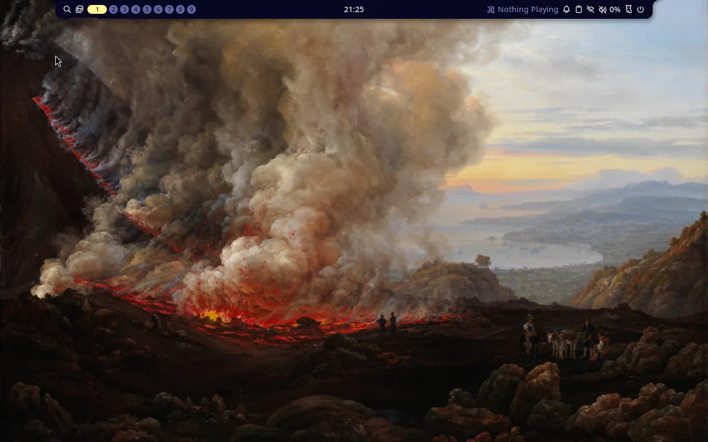
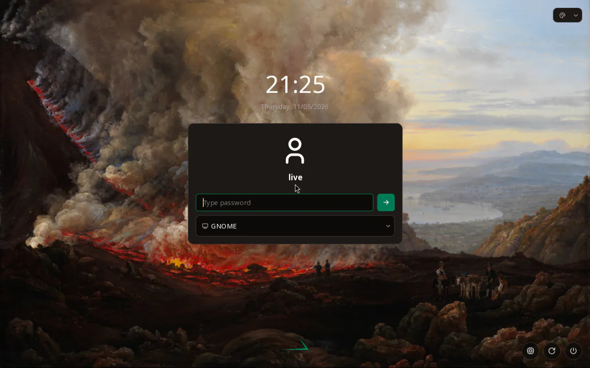
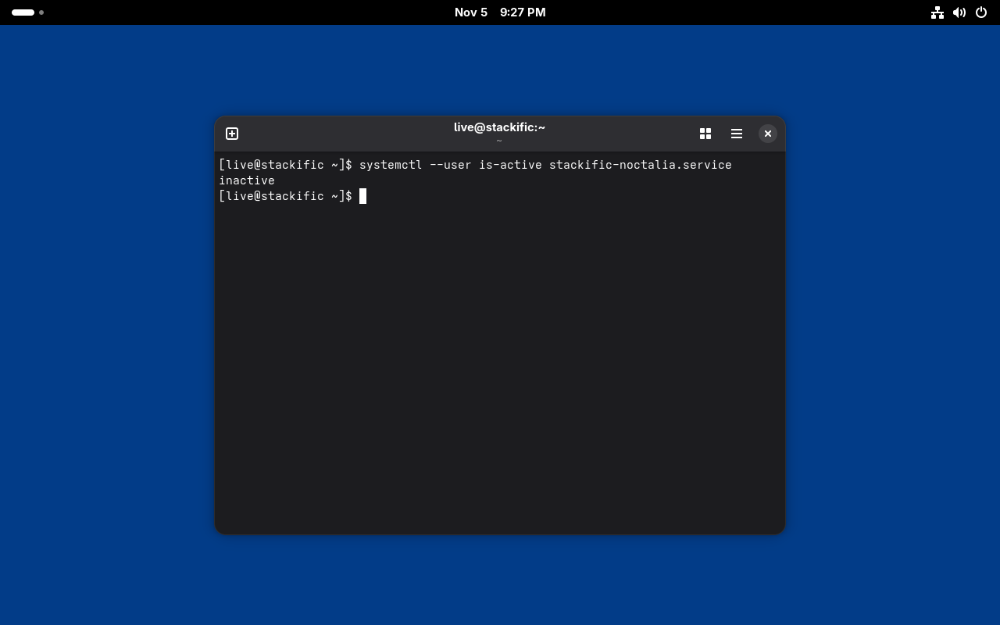

## Goal

`just fedora iso` builds a Fedora 45 x86_64 live ISO that boots into MangoWM with Noctalia as the user `live`, with GNOME available from noctalia-greeter, and identifies as Stackific OS. `just fedora test` proves that session runs with SELinux enforcing and that the greeter shows after a logout.

## Context

Before this step, the Fedora ISO was console only: root logged in automatically on tty1, and os-release said `Generic`. Task 007 built our three packages as Fedora RPMs into a local repo. This step installs them, adds MangoWM and noctalia-greeter from Terra, the rest of the desktop and GNOME from Fedora, a live user and greetd, and mirrors the Arch desktop image from task 002 and its boot-test checks.

## Expectations

Must:

- `just fedora iso` exits 0 and its last line prints the ISO size in MiB. The manifest `.build/fedora/x86_64/stackific-0.0.0-dev-fedora-x86_64.packages.txt` lists `stackific-release`, `stackific-desktop`, `stackific-artwork`, `mangowm`, `noctalia`, `noctalia-greeter`, `greetd`, `greetd-selinux`, `gnome-shell`, `generic-logos` and `NetworkManager-wifi`, and no `fedora-release`, `fedora-release-common`, `fedora-release-identity-*`, `fedora-logos`, `fedora-release-notes`, `generic-release` or `cardwire`.
- With a different key in `fedora/iso/terra-45.asc` (Terra 44's, from https://repos.fyralabs.com/terra44/key.asc), `just fedora iso` fails on Terra's signature check. Run once during /s-build, then restore the key; the review record quotes the error.
- `just fedora test` exits 0, with these checks printed `ok`: `running`, NetworkManager `running`, wrong token rejected, the os-release fields and `hostnamectl`, `generic-release-common` owning the `/etc/os-release` link and `stackific-release` owning `/usr/lib/os-release`, no Fedora release or logo packages, the icon's accent fill, only `mangowm` and `noctalia-greeter` from Terra, `Enforcing`, greetd `active` as `display-manager.service`, `stackific-noctalia.service` `active` for `live`, a `mango` PID for `live`, both session files, the artwork, Noctalia, greeter and fastfetch checks of item 8, `greetd` owning `/var/lib/noctalia-greeter`, a `noctalia-greeter` PID for `greetd` after the logout, and `0` AVC denials.
- `.build/fedora/x86_64/screen.png` shows the MangoWM desktop with Noctalia's bar, and `.build/fedora/x86_64/greeter.png` shows noctalia-greeter over Dahl's Vesuvius in our emerald palette, with our logo where Noctalia's was.
- The manual GNOME steps in Tests pass, or the review record says which step failed and the operator decides.
- `just lefthook all` passes (shellcheck covers `terra-repo.sh`).
- The task report states the ISO size in MiB against the 2048 MiB target.

Must not:

- change a file owned by mangowm, noctalia, noctalia-greeter, greetd or any GNOME package, except greetd's `config.toml` in the live image;
- take any package from Terra other than `mangowm` and `noctalia-greeter`, or turn Terra's signature checks off;
- start Noctalia in the GNOME session;
- add `NOPASSWD`, a sudoers file or a polkit rule anywhere;
- keep the tty1 root autologin, or ship anything from `tests/`, an SSH server (`openssh-server`), `cloud-init` or a VM guest agent in the image. `openssh` (`ssh-keygen`) and `openssh-clients` are in it: `noctalia` requires `git-core`, which requires `openssh-clients`, which requires `openssh` (`dnf repoquery --requires`), and neither holds sshd;
- use sudo or root on the host;
- touch files outside the Changes list (the review record, prompt-trail entry and its screenshots from /s-build excepted);
- add a dependency this task does not name.

## Prompt

```text title="Prompt" wrap
Turn the Fedora 45 x86_64 console live ISO from task 003 into a desktop live ISO that mirrors the Arch one from task 002. It boots straight into MangoWM with Noctalia: greetd logs the user `live` (empty password, group `wheel`) in through `initial_session`, and noctalia-greeter is the login screen after a logout, where GNOME is the second session. Take MangoWM and noctalia-greeter from Terra, with Terra's repo limited by `includepkgs` to those two (unlimited, dnf takes Terra's cardwire for gnome-shell's switcheroo-control) and Terra's packages and metadata checked against Terra 45's key, committed verbatim; take everything else unmodified from Fedora's repos, scenefx and Noctalia included. kiwi has no attribute for either repo line, so a repository `customize` script appends `includepkgs=` and `gpgkey=` to the repo file kiwi writes. Install our three Fedora packages from task 007 (stackific-release, stackific-desktop, stackific-artwork) from the local repo that `just fedora packages` builds, mounted read-only into the build, so `stackific-noctalia.service` starts Noctalia and `WLR_RENDERER_ALLOW_SOFTWARE=1` lets MangoWM start on software rendering. Keep Fedora's trademark rules: no fedora-release*, fedora-logos or fedora-release-notes in the image; gdm, which gnome-shell requires, needs `system-logos`, so name `generic-logos`. gdm stays installed but disabled, and greetd becomes `display-manager.service`. Of the weak dependencies, keep only Wi-Fi and the Adwaita fonts. Terra's noctalia-greeter ships no tmpfiles file, so create its state directory for Fedora's greeter user `greetd`. The login screen carries our branding, not Noctalia's, as on Arch: our palette, Dahl's Vesuvius and our logo through stackific-desktop's greeter files. Extend the QEMU boot test (tests/vm/fedora-x86_64.sh) with every check the Arch desktop test makes, fastfetch's logo included, plus the image's identity, the packages from Terra and SELinux (enforcing, no AVC denials), with a screenshot of the desktop and of the greeter. On Fedora, rpm names the owner of the /etc/os-release link (generic-release-common), and `systemctl --user -M live@` fails under SELinux, so check the user unit through runuser. Prove a wrong Terra key stops the build. Report the ISO size against the 2 GiB target, and document the repositories, the key, the live session, the checks and the manual GNOME login, which needs any character typed because noctalia-greeter refuses an empty password field.
```

## Outcome

The ISO now boots to a desktop. kiwi installs from four repositories: Fedora and its updates, Terra and our local repo. `fedora/iso/terra-repo.sh` limits Terra to `mangowm` and `noctalia-greeter` and names Terra 45's key, `fedora/iso/terra-45.asc`, for the metadata check. Every Terra package is checked against the same key. `stackific-release` replaces `generic-release` in the bootstrap, and `generic-logos` keeps `fedora-logos` out. `config.sh` creates `live`, disables gdm and enables greetd, whose live-only config logs `live` into MangoWM and runs noctalia-greeter as `greetd` after a logout.

The boot test now makes every check of the Arch desktop test, with Fedora's names, plus Terra and SELinux. Two of Arch's checks needed a Fedora form. rpm names the owner of the `/etc/os-release` link, `generic-release-common`, so the check asks for both files. `systemctl --user -M live@` failed: it passes the test shell's vsock socket to PID 1 and dbus-broker, which Fedora's SELinux policy silently denies, so the unit check runs `systemctl --user` as `live` through `runuser`.

The ISO is 1488 MiB against the 2048 MiB target, with 677 packages. The boot test passes in about 44 s with 4 GiB of RAM. With Terra 44's key in place of Terra 45's, the build stops with `repomd.xml GPG signature verification error: Signing key not found`.

The GNOME login works, but not exactly as the task's manual steps first said. noctalia-greeter refuses an empty password field. Typed into the field, any character logs `live` in, because PAM does not ask for an empty password. GNOME then starts without Noctalia. Without gdm, GNOME turns its screen lock off and says so.

### Screenshots



_The live session after boot: no login prompt, Noctalia's bar on MangoWM over Vesuvius, and no first-run wizard._



_After `loginctl terminate-user live`, noctalia-greeter runs as `greetd` in our palette, with our logo at the bottom centre. The picker lists GNOME first._



_GNOME from the greeter, logged in with one typed character: in Ptyxis, `stackific-noctalia.service` is `inactive`, so Noctalia stays out of GNOME._

## Review

- **Round 1** found four things, all fixed:
  - AGENTS.md now keeps the test-shell gotcha, so the Fedora aarch64 task does not hit it again.
  - The docs gave the console ISO's 2 GiB as the build's tmpfs size. A sampled rebuild peaks at 5398 MiB, so the docs now say a build host needs about 12 GiB of RAM or an explicit `size=`.
  - The docs gave a guessed reason for the greeter listing GNOME first; only the order stays.
  - The entry claimed the manual steps had run when two had not. All four then ran by keystrokes, and the GNOME screenshot comes from that run.
- **Round 2** found two docs slips, both fixed. The docs called greetd's config the image's only change to a package's file, though `config.sh` also changes the account files. The steps for Fedora 46's key left out AGENTS.md.
- **Round 3** found nothing.

## Manual changes

None. All four manual GNOME steps ran in the boot-test VM, with keystrokes sent through QEMU's monitor: `Alt+Return` opened foot, `loginctl terminate-user live` typed into it brought up the greeter, one typed character logged `live` into GNOME, and in Ptyxis, opened from GNOME's search, `systemctl --user is-active stackific-noctalia.service` printed `inactive`. The operator can repeat them on a VM with a display, as the task's Tests describe.

## Result

The Fedora live ISO is now a desktop image:

- `fedora/iso/config.kiwi` adds the Terra and `stackific` repositories, `stackific-release` in the bootstrap, and the desktop, GNOME, sound, portal, Wi-Fi and font packages, with `generic-logos` for `system-logos`.
- `fedora/iso/terra-repo.sh` appends `includepkgs` and `gpgkey` to Terra's repo file, and `fedora/iso/terra-45.asc` is Terra 45's key, committed verbatim.
- `config.sh` creates `live`, disables gdm and enables greetd. `root/etc/greetd/config.toml` holds the live session, and `root/etc/tmpfiles.d/noctalia-greeter.conf` creates the greeter's state directory for `greetd`. The tty1 root autologin is gone.
- `just fedora iso` builds our RPMs first and mounts their repo read-only.

Verified on a Linux host with rootless podman 6.1.4:

- `just fedora iso` exits 0 in about 5 minutes and prints `1488 MiB (target 2048 MiB)`. The manifest has 677 packages, among them `mangowm 0.18.5-1.fc45`, `noctalia 5.4.1-1.fc45`, `noctalia-greeter 1.7.0-2.fc45`, `greetd` and `greetd-selinux 0.10.3-12.fc45`, `gnome-shell 51.1-1.fc45` and our three RPMs. It has no `fedora-release*`, `fedora-logos`, `fedora-release-notes`, `generic-release`, `cardwire`, `openssh-server`, `cloud-init` or guest agent.
- With Terra 44's key, the build stops on `repomd.xml GPG signature verification error: Signing key not found`. Terra 45's key went back, with its sha256 checked.
- `just fedora test` prints `PASS` in about 45 s, with every check `ok`, including 0 AVC denials.
- The manual GNOME steps pass in the VM, with one typed character at the greeter; Ptyxis prints `inactive` for `stackific-noctalia.service`.
- `just lefthook all` passes all 12 checks, and the same checks pass on the new, untracked files run directly. `just doctor` prints `fedora: ok`.

After the build, the operator kept `live`'s empty password: noctalia-greeter refuses an empty field, so users type any character there. The new user page `site/src/content/docs/user/live-session.md` and `AGENTS.md` say so, for all four images.

Docs: the developer notes `docs/fedora-iso.md` gain the repositories and Terra's key, the live session and the manual GNOME check, and the new boot-test checks; the build section now gives the measured tmpfs size. `AGENTS.md` updates its Terra and Fedora logo lines, and gains the test-shell gotcha. There are no user docs: nothing is released.

## Deviations

- The task's Arch-parity checks grew to all of `tests/vm/arch-x86_64.sh`: the icon fill, the wallpapers, the `/etc/skel` include, Noctalia's merged config, the greeter's palette and logo link, and fastfetch's logo and `OS:` line. AGENTS.md makes the four images one product with the same boot-test checks, and every image's boot test checks fastfetch's logo. The os-release check also reads `VERSION_ID`, Fedora's per-base field, where Arch reads `BUILD_ID`. The task file is updated.
- `rpm -qf /etc/os-release` prints `generic-release-common`, the owner of the link, not `stackific-release` (measured in the pinned base, where it prints `fedora-release-common`). The check and its criterion now name both files, as AGENTS.md describes the Fedora release package. The task file is updated.
- `systemctl --user -M live@` fails on Fedora under SELinux (measured: it works after `setenforce 0`, and `semodule -DB` shows the denials), so the unit check uses `runuser`. The task file is updated.
- `openssh` and `openssh-clients` are in the image, required through `noctalia` and `git-core`; there is no `openssh-server`. The must-not named `openssh`; it now names the SSH server. The task file is updated.
- Manual step 3 said to leave the password empty, which noctalia-greeter refuses. The step now says to type any character. The task file is updated, and the review record leaves the decision to the operator.
- AGENTS.md gains a Tests line on the Fedora test-shell gotcha, beyond the two Builds lines the task names, because AGENTS.md keeps durable gotchas.
- The entry has a third screenshot, GNOME with Ptyxis, as evidence for the manual steps.
