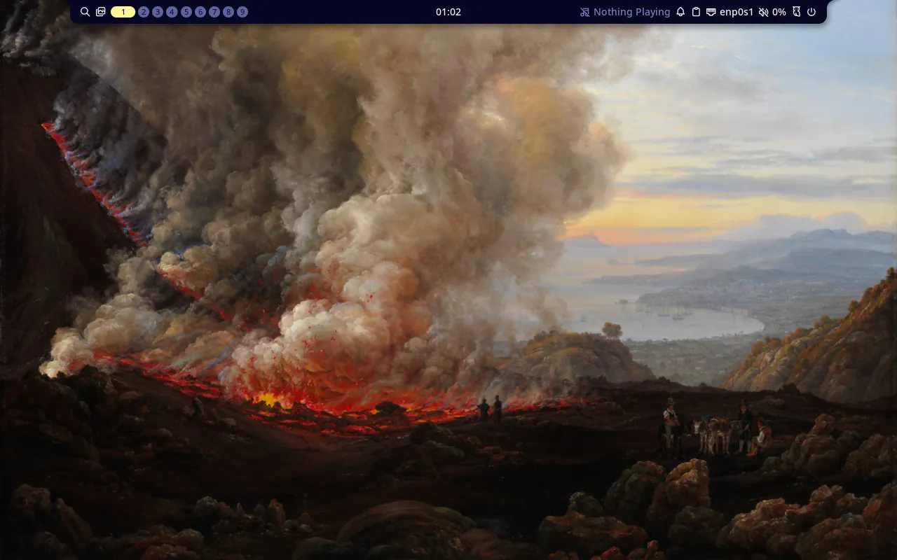
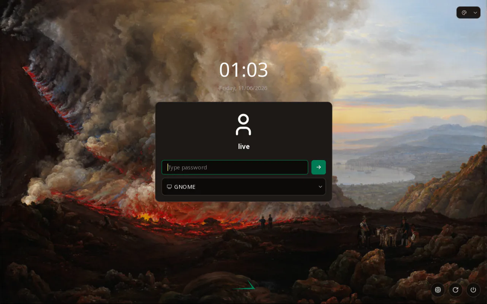

## Goal

In the Mac's runner VM, `just fedora iso` builds a Fedora 45 aarch64 live ISO that looks and behaves like the x86_64 one. It boots into MangoWM with Noctalia as `live`, with our noctalia-greeter and GNOME available from it. `just fedora test` runs the same Fedora checks there as on x86_64, and the `images` and `release` workflows build, test and publish it.

## Context

Before this step, the Fedora image built for x86_64 only: task 008's desktop, from a kiwi description, builder and recipes that named x86_64 GRUB, microcode, OVMF and file names. Task 009 had just made the Arch aarch64 image match x86_64. This step builds the same Fedora description natively on aarch64, with one check file for both Fedora images.

## Expectations

Must:

- In the runner VM, `just fedora iso` exits 0 and writes `.build/fedora/aarch64/stackific-0.0.0-dev-fedora-aarch64.iso` and its `.packages.txt`. Its last line prints the ISO size in MiB against 2048 MiB, and the ISO is 2048 MiB or less.
- The aarch64 manifest has these names, each as the first field of a line: `stackific-release`, `stackific-desktop`, `stackific-artwork`, `mangowm`, `noctalia`, `noctalia-greeter`, `greetd`, `greetd-selinux`, `gnome-shell`, `generic-logos`, `NetworkManager-wifi`, `grub2-efi-aa64`, `grub2-efi-aa64-cdboot`, `grub2-efi-aa64-modules` and `kernel`.
- The aarch64 manifest has none of these: `fedora-release`, `fedora-release-common`, `fedora-release-identity-*`, `fedora-logos`, `fedora-release-notes`, `generic-release`, `cardwire`, `grub2-efi-x64*`, `amd-ucode-firmware`, `microcode_ctl` or `openssh-server`.
- `grep '<package .*arch=' fedora/iso/config.kiwi` prints eight lines: five with `arch="x86_64"` (`grub2-efi-x64`, `grub2-efi-x64-cdboot`, `grub2-efi-x64-modules`, `amd-ucode-firmware`, `microcode_ctl`) and three with `arch="aarch64"` (the `grub2-efi-aa64*` packages). It prints nothing else.
- In the runner VM, `just fedora test` exits 0, and every check of `tests/vm/fedora.sh` prints `ok` on aarch64:
  - the os-release fields and `hostnamectl`; `generic-release-common` owns `/etc/os-release` and `stackific-release` owns `/usr/lib/os-release`; no Fedora release or logo packages; the icon's accent fill;
  - only `mangowm` and `noctalia-greeter` come from Terra;
  - `Enforcing`;
  - greetd is `active` as `display-manager.service`; `stackific-noctalia.service` is `active` for `live`, and `live` runs `mango`; both session files exist;
  - the wallpaper, Noctalia, greeter and fastfetch checks;
  - `greetd` owns `/var/lib/noctalia-greeter`, and a `noctalia-greeter` PID runs as `greetd` after the logout, with our asset folder in its environment;
  - `0` AVC denials.
- `just fedora test` leaves `.build/fedora/aarch64/screen.png` and `greeter.png`:
  - `screen.png` shows MangoWM with Noctalia's bar on "An Eruption of Vesuvius", with no setup wizard;
  - `greeter.png` shows noctalia-greeter in our palette on the same painting, with the Stackific logo.
- `git diff -M main` shows `tests/vm/fedora-x86_64.sh` renamed to `tests/vm/fedora.sh`, with only its header comment changed.
- On the operator's PC, `just fedora iso` and `just fedora test` pass on this branch. The x86_64 manifest still lists `grub2-efi-x64`, `grub2-efi-x64-cdboot`, `amd-ucode-firmware` and `microcode_ctl`, and lists no `grub2-efi-aa64*`.
- After the merge, the `images` run on `main` passes every job, `fedora-aarch64` included. The test release `v0.0.0-pr.<n>` holds `stackific-0.0.0-pr.<n>-fedora-aarch64.iso`, its `.packages.txt` and its `.iso.sha256`.
- `just lefthook all` passes: actionlint covers the workflows, and shellcheck covers `tests/vm/fedora.sh` and `tests/vm/boot.sh`.
- The task report states:
  - the aarch64 ISO size in MiB against the 2048 MiB target;
  - the versions the aarch64 manifest took for `mangowm`, `noctalia`, `noctalia-greeter`, `greetd`, `gnome-shell` and `kernel`;
  - the work tmpfs peak in the runner VM.
- If the build runs out of room on the work tmpfs (`No space left on device` under `/work`, or xorriso's `exceeds free space on media`), stop and tell the operator, with the measured peak. The fix is an explicit tmpfs `size=` in `fedora/justfile`, or more memory for the VM in `just runner vm`, and the operator picks.

Must not:

- change any check in the moved check file, any package line of the x86_64 set other than its `arch="x86_64"` attribute, or `config.sh`, `root/`, `terra-repo.sh`, `terra-45.asc`, `fedora/packages/`, `desktop/` or `branding/`;
- add a second kiwi description, a kiwi profile, or an architecture-specific Fedora check file;
- take any package from Terra other than `mangowm` and `noctalia-greeter`, or turn Terra's signature checks off;
- cross-build, emulate (qemu-user or TCG), or pin Fedora packages;
- add `NOPASSWD`, a sudoers file or a polkit rule;
- use sudo or root on the host;
- touch files outside the Changes list (the review record, prompt-trail entry and its screenshots from /s-build excepted), or add a dependency this task does not name.

## Prompt

```text title="Prompt" wrap
Build the Fedora 45 desktop live ISO from task 008 for aarch64 too, so it is the same product as the x86_64 image, as AGENTS.md asks. Skip a separate console step: tasks 003 and 008 settled the layout, so this task only adds the architecture. The image boots straight into MangoWM with Noctalia as the user live. noctalia-greeter shows our logo, palette and wallpaper, and GNOME is the second session. Terra supplies only mangowm and noctalia-greeter, and its key is checked. SELinux is enforcing, and no Fedora trademark packages are in the image. Build it natively in the Mac's runner VM from the same kiwi description, builder and recipes, with the host's architecture picking the image, as on Arch. The package list differs only where aarch64 forces it: kiwi's arch attribute keeps the GRUB packages and the x86 CPU microcode to their architecture, and every other line serves both. Both Fedora images then pass the same checks, so the boot test runs one Fedora check file on both, with a screenshot of the desktop and of the greeter. Add the image to the images and release workflows on the Mac's runner. Report the ISO size against the 2 GiB target, and the work tmpfs peak. The runner VM enforces SELinux, so kiwi's work and temp dirs go on a tmpfs the container mounts itself: podman's own --tmpfs and overlay take no SELinux labels there. A rootless build can set only the SELinux contexts the build host's policy knows, so the runner VM runs Fedora 45, the images' release, pinned in just runner vm; just setup on a Mac makes that VM, and just doctor checks its release. The build's tmpfs peaks at 6763 MiB on aarch64, above half of 12 GiB, so the VM has 16 GiB of memory.
```

## Outcome

One kiwi description now builds both Fedora images. `config.kiwi` marks eight packages with kiwi's `arch` attribute, which kiwi compares with the build host's architecture. On x86_64 they are the three `grub2-efi-x64*` packages and the x86 CPU microcode (`amd-ucode-firmware`, `microcode_ctl`); on aarch64 they are the three `grub2-efi-aa64*` packages. Every other line serves both, so the two package sets cannot drift apart. The kernel command line names both serial consoles, `ttyS0` and `ttyAMA0`, as on Arch.

The builder installs QEMU and UEFI firmware for its host: OVMF on x86_64, and on aarch64 `qemu-system-aarch64-core` with AAVMF and the `virtio-gpu-pci` display. The recipes take the architecture from the host: outputs go to `.build/fedora/<arch>/`, and the boot test gives QEMU AAVMF's 64 MiB pflash pair on aarch64. `tests/vm/fedora-x86_64.sh` became `tests/vm/fedora.sh`, with its checks unchanged, and both Fedora images pass it. The `images` and `release` workflows have a `fedora-aarch64` job on the Mac's runner.

The aarch64 ISO is 1431 MiB, with 673 packages. It takes the same desktop versions as x86_64, from Terra and Fedora's aarch64 repos. Every check of `tests/vm/fedora.sh` passes on aarch64 under nested KVM. MangoWM, Noctalia and the greeter draw on QEMU's `virtio-gpu-pci` with Mesa's software renderer.

Three things about the Mac's runner VM came out of the build:

- **Its SELinux.** podman mounts its own `--tmpfs`, like its overlay, with one fixed `context=`, so kiwi could not label the image there. The build now mounts its work tmpfs inside the container and gives kiwi `--temp-dir` on it.
- **Its Fedora release.** A rootless build may set only the contexts the host's policy knows, so the VM moved from Fedora 44 to Fedora 45, the images' release.
- **Its memory.** The work tmpfs peaks at 6763 MiB on aarch64, above half of the VM's former 12 GiB, so the VM now has 16 GiB.

The release and the memory are pinned in `just runner vm`. `just setup` on a Mac now makes that VM, and `just doctor` checks its release.

### Screenshots



_The Fedora aarch64 live desktop: MangoWM with Noctalia on Dahl's "An Eruption of Vesuvius", with no setup wizard. It is rendered in software on the Mac's runner VM._



_After a logout, noctalia-greeter runs as Fedora's `greetd` user, in our palette over the same painting, with GNOME as the session and the Stackific logo at the bottom, the same as on x86_64._

## Review

- Round 1 found one issue, in the chore part. A new Mac's VM image came from one location, Fedora's mirror redirector, which kept sending downloads to a dead mirror during the build. `just runner vm` now lists the same file on Fedora's own server as a second location with the same digest, and Lima falls back to it. A throwaway VM proved the fallback.
- Round 2 found two doc errors. The README said to wait for the VM to stop after its in-place upgrade, but it restarts on its own. The Prompt here gave the tmpfs peak as an estimate rather than the measured 6763 MiB. Both were fixed.
- Round 3 found nothing.

## Manual changes

The build ran on the Mac's runner VM, driven from the Mac's worktree: the tree went into the VM as one copy, and the recipes ran there with `limactl shell`. On the operator's choices, the VM was upgraded in place from Fedora 44 to Fedora 45 (`dnf system-upgrade`, then `dnf offline reboot`), and resized from 12 to 16 GiB (`limactl edit --memory 16`). Both are VM administration, done with sudo inside the VM; the image build itself stayed rootless.

Still to do by hand:

- Before the merge, on the PC: `just fedora iso` and `just fedora test` must pass, and the x86_64 manifest must keep its x86_64 GRUB and microcode packages.
- After the merge: the `images` run on `main` must pass every job, `fedora-aarch64` included, and the test release must hold the Fedora aarch64 ISO.

## Result

In the Mac's runner VM (Fedora 45, Apple M4 Pro, nested KVM, 16 GiB):

- `just fedora iso` exits 0 and prints `1431 MiB (target 2048 MiB)`. The work tmpfs peaked at 6763 MiB of its 7971 MiB cap.
- The manifest has 673 packages, including:
  - our packages: `stackific-release 0.1.0-1.fc45`, `stackific-desktop 0.2.0-1.fc45` and `stackific-artwork 0.1.0-1.fc45`;
  - from Terra: `mangowm 0.18.5-1.fc45` and `noctalia-greeter 1.7.0-2.fc45`;
  - from Fedora: `noctalia 5.4.1-1.fc45`, `greetd` and `greetd-selinux 0.10.3-12.fc45`, `gnome-shell 51.1-1.fc45`, `generic-logos 18.0.0-29.fc45` and `NetworkManager-wifi 1.58.1-3.fc45`;
  - `kernel 7.2.15-300.fc45` and the three `grub2-efi-aa64*` packages at `2.12-83.fc45`.

  It has no `fedora-release*`, `fedora-logos`, `fedora-release-notes`, `generic-release`, `cardwire`, `grub2-efi-x64*`, `amd-ucode-firmware`, `microcode_ctl` or `openssh-server`.

- `grep '<package .*arch=' fedora/iso/config.kiwi` prints the eight package lines.
- The rename to `tests/vm/fedora.sh` changes only the file's header comment.
- `just fedora test` prints `PASS`, with every check of `tests/vm/fedora.sh`:
  - identity, Terra's two packages, `Enforcing`;
  - greetd as the display manager, and the session;
  - the wallpapers, Noctalia's defaults, the greeter and fastfetch;
  - the greeter after a logout, and `0` AVC denials.

  It leaves `screen.png`, `greeter.png` and `serial.log`.

- `just dev check`, shellcheck, actionlint, the justfiles, Prettier, the screenshot check, the site build, `git diff --check` and gitleaks pass. `NOPASSWD` and `polkit` appear nowhere in `fedora`, `tests` or `desktop`.
- `just runner check` prints `runner vm: ok (stackific-runner, Fedora 45)`.

Docs:

- `docs/fedora-iso.md` says the host's architecture picks the image, and why kiwi's work and temp dirs are on a tmpfs the container mounts itself. It explains why the build host's Fedora release must match the image's, and how large the tmpfs gets. A new aarch64 section lists what differs, and moving the builder digest now runs the test gate on both hosts.
- `docs/releases.md` says the release holds all four images.
- `AGENTS.md` and `README.md` say how the Mac's VM is pinned and made.

No user docs: the image looks the same as on x86_64, and nothing is released yet.

## Deviations

- The task was missing three facts about building on an SELinux host, all found during the build:
  - podman's `--tmpfs` takes no labels there;
  - kiwi's default temp dir is on podman's overlay;
  - the host's policy must know the image's contexts.

  The task file now records them, and its `fedora/justfile` change mounts the work tmpfs in the container and gives kiwi `--temp-dir`.

- The task's mirror criterion, `grep 'arch='`, also matched two existing repository lines. It now greps `<package .*arch=`.
- A chore rides on the same branch, as its own commit, outside the task's Changes list: the Mac's VM runs Fedora 45 with 16 GiB, both on the operator's choice. It touches `just/runner/vars.just`, `just/runner/mod.just`, the root `justfile`, `README.md`, and the `just setup` and `just doctor` lines in `AGENTS.md`. `just runner vm` pins the image with a fallback location, `just setup` runs it on a Mac, and `just doctor` checks the VM's release.
- The VM's in-place upgrade and resize used sudo inside the VM. That is VM administration; the image build stayed rootless.
