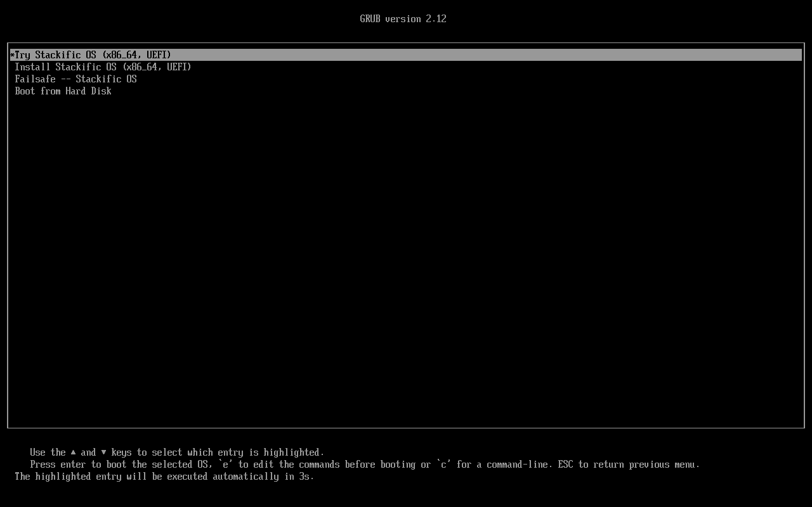
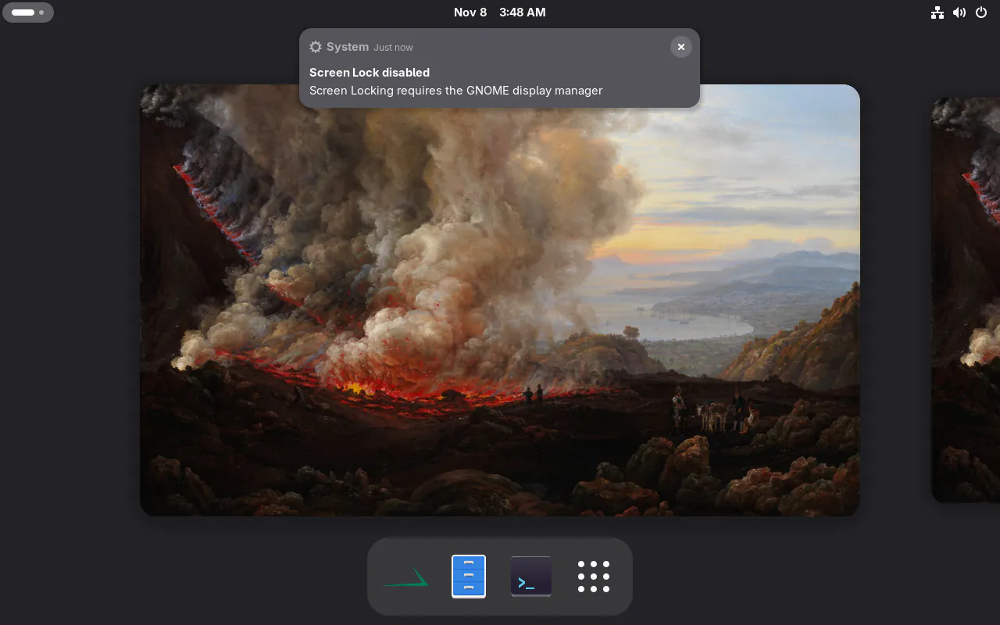
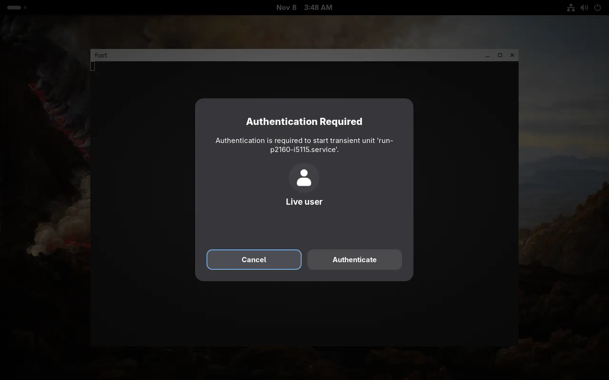
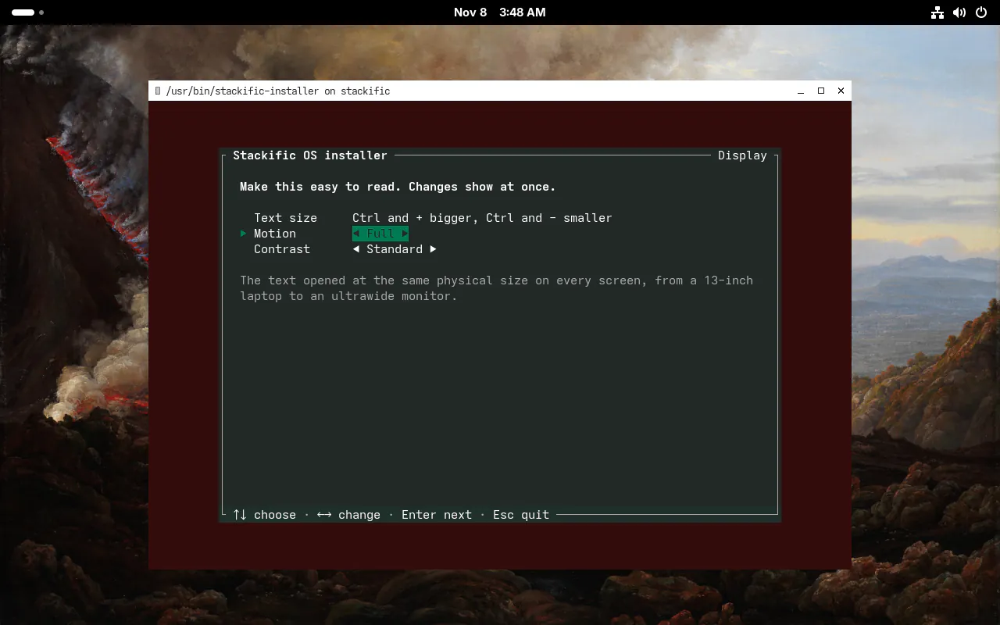
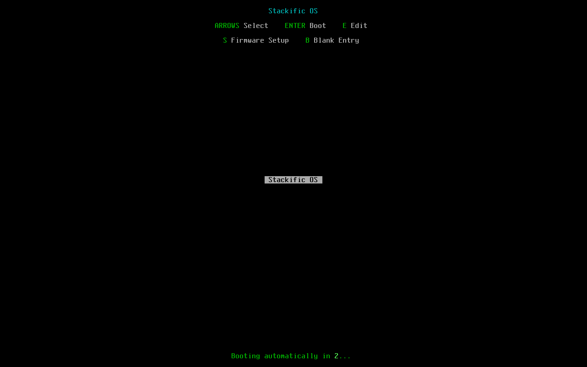
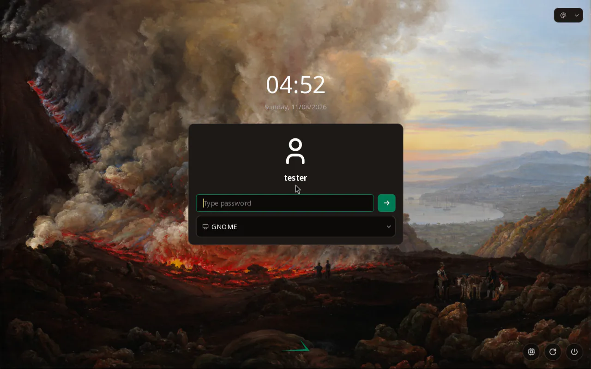

## Goal

The Fedora x86_64 live ISO installs Stackific OS in both modes, from the launcher or the boot menu. The installed system starts through the firmware's "Stackific OS" entry and Limine, reaches its login screen with SELinux enforcing, and keeps Limine's menu current when dnf5 installs or removes a kernel. `just fedora test-install` proves it.

## Context

Tasks 012 and 013 built the installer and the boot chain on Arch x86_64, with base differences behind the installer's `Base` trait. The Fedora images had no installer, no Limine (Fedora does not package it), no dnf5, and GNOME started on its own wallpaper. This step adds Fedora's `Base`, the installer and boot RPMs, the boot-menu entry, GNOME's defaults and Fedora's install test.

## Expectations

Must:

- `just installer test` and `just installer lint` pass; unit tests cover `detect` for both bases, Fedora's live paths, its `dnf5` removal command, its chroot and `kernel-install` commands, the relabel command, and that Arch's commands and `limine.conf` are unchanged; `just installer demo` runs to Done.
- `just fedora packages` builds `stackific-installer` (x86_64), `stackific-boot` and `stackific-desktop` with every spec's `%check` passing; `rpm -qlp` of `stackific-boot` lists exactly the drop-in and the plugin (plus folders); `rpm -qlp` of `stackific-installer` lists the same paths as `pacman -Qlp` of the Arch package.
- `just fedora iso` builds and prints the ISO size (target 2048 MiB); its manifest lists `dnf5`, `limine 12.9.6-1.fc45`, `stackific-installer`, `stackific-boot`, `efibootmgr`.
- `just fedora test` passes, and also: Terra supplies exactly `limine mangowm noctalia-greeter`; `gsettings get org.gnome.desktop.background picture-uri` as `live` prints our painting's URI (`picture-uri-dark` and the screensaver's too); `favorite-apps` starts with `'stackific-installer.desktop'`; a screenshot shows GNOME with our wallpaper (the test logs `live` into GNOME through greetd's `[initial_session]` from the test shell).
- `just fedora test-install` passes:
  - the ISO's `grub.cfg` has "Try Stackific OS (x86_64, UEFI)" as default and "Install Stackific OS (x86_64, UEFI)" with `systemd.unit=stackific-installer.target`;
  - the first boot passes every check `install.sh` runs on Arch (console path, refused erase, erase, Windows-like table with the BitLocker refusal, free-space install), with Fedora's equivalents for the base-specific ones;
  - the second boot, from the disk alone: OVMF starts `Boot#### "Stackific OS"`; `limine.png` shows Limine's menu with "Stackific OS" first; the system reaches `running`, `getenforce` prints `Enforcing`, the login screen shows; `/proc/cmdline` has `root=UUID=<UUID of />`, `rootflags=subvol=/@`, `rw`; `findmnt` shows `/` btrfs `subvol=/@` and `/boot` vfat; `btrfs subvolume get-default /` prints `ID 5 (FS_TREE)`;
  - `/boot` holds `vmlinuz-<uname -r>`, `initramfs-<uname -r>.img`, `limine.conf` and both `BOOTX64.EFI` copies, and no `*rescue*`, no `loader/`, no `EFI/Linux/`, no `grub2/`; `lsinitrd` of the initramfs lists `btrfs` and no `dmsquash-live`;
  - `rpm -q stackific-installer` and `rpm -qa 'grub2*'` print nothing installed; `stackific-boot`, `limine`, `efibootmgr`, `dnf5` are installed; `ls -Zd /home/tester` shows `user_home_dir_t`; `restorecon -nRv /etc /home /var/lib` prints nothing;
  - the plugin: `kernel-install add 0.0.1-test /boot/vmlinuz-<uname -r> /boot/initramfs-<uname -r>.img` adds a second entry after the running kernel's; `kernel-install remove 0.0.1-test` takes it and its files away; `dnf5 reinstall -y /boot/kernel-core-*.rpm` (offline, from the ESP) leaves `limine.conf` with the running kernel's entry and its files current; after both EFI copies are emptied, `rpm -Uvh --replacepkgs /boot/limine-*.rpm` restores them; the firmware entries are unchanged by all of these;
  - hostname `stackific-test`, timezone `Europe/Berlin`, `localectl` X11 layout and keymap `de`, `tester` in `wheel`; logged into MangoWM, `mmsg get keyboardlayout` as `tester` prints the German layout; logged into GNOME, `gsettings get org.gnome.desktop.input-sources sources` (or `mru-sources`) as `tester` shows `('xkb', 'de')`. If GNOME shows `us`, the build fixes it and says so in the prompt trail.
- `just arch packages`, `just arch iso`, `just arch test` and `just arch test-install` still pass (the shared crate changed).
- `just lefthook all` passes (shellcheck on the plugin and changed scripts, actionlint, `just dev check`, the site's checks).

Must not:

- use limine-entry-tool, limine-snapper-sync, grubby or GRUB on installed systems, or any AUR or COPR package;
- build a rescue or fallback initramfs or a UKI, or enroll a Limine config hash;
- turn SELinux to permissive or disabled anywhere, or use `/.autorelabel`;
- write to another OS's ESP, set the btrfs default subvolume, or write NVRAM outside the installer's last step;
- add the installer, `stackific-boot` or a boot entry to either aarch64 image (task 018);
- change Arch's installed result (only the shared code moves);
- touch files outside the Changes list, or add a dependency this task does not name.

## Prompt

```text title="Prompt" wrap
Bring the installer to the Fedora 45 x86_64 live ISO, so it installs Stackific OS into a drive's free space or onto a whole drive, as on Arch x86_64, and the installed system starts from Limine on our own 4 GiB FAT32 ESP. Reuse the one installer crate: add a Fedora implementation of its Base trait and an RPM, stackific-installer, built with mock. Kernel updates keep Limine's menu current through Fedora's own kernel-install and dracut, with one small kernel-install plugin of ours (Limine reads no Boot Loader Spec entries, and no Limine helper is packaged for Fedora); Limine comes from Terra. The installed system keeps no GRUB, keeps SELinux enforcing with correct labels, and can update with dnf5, which the Fedora images gain. Open the installer from the live desktop's "Install Stackific OS" launcher, which GNOME's dash lists first, and from an "Install Stackific OS" entry in the live ISO's boot menu beside "Try". GNOME, Fedora's second desktop, starts with our wallpaper (Dahl's "An Eruption of Vesuvius"), as Noctalia and Plasma do. Add `just fedora test-install`, which installs in both modes and boots the installed disk, as `just arch test-install` does. Wherever SELinux or Fedora's tools refuse what the Arch path does, fix the installer at the root, never by turning SELinux down: label the account files before chpasswd, hash the password without PAM, create the user in a chroot so it gets /etc/skel, relabel every subvolume, and give the live ISO a volume label the installed ESP does not share. In the tests, log into GNOME through the login screen, because GNOME starts only in a wayland session.
```

## Outcome

**The installer on Fedora.** The installer picks `Fedora` behind its `Base` trait when os-release's `ID_LIKE` is `fedora`. It copies the live image's pristine root from `/run/rootfsbase` (dracut's dmsquash-live), and hides the drive under `/run/initramfs/live`. Fedora's steps differ from Arch's in four places:

- **Live state:** proc, sysfs, `/dev` and a non-recursive bind of `/run` go into the target, as arch-chroot mounts them. Then `dnf5 --installroot … remove` takes the installer and the live image's GRUB off the target, offline, lifting GRUB's own package protection for this removal only. The installed system has no GRUB, so GRUB's kernel-install plugins never run there.
- **Kernel and initramfs:** the installer writes `/etc/kernel/cmdline` (`root=UUID=… rootflags=subvol=/@ rw`, the same text Arch's `limine.conf` carries) and runs `kernel-install add` in a chroot, as the kernel package's own scriptlet does. Fedora's dracut plugin builds `/boot/initramfs-<version>.img` (hostonly, no rescue image), and our plugin writes the rest.
- **Labels:** SELinux stays enforcing throughout. `setfiles` relabels the target's `/etc` between `useradd` and `chpasswd`, and at the end relabels `/` and every subvolume's mount point, before the firmware entry.
- **The user:** `useradd` runs in a chroot, so it copies `/etc/skel`. chpasswd hashes with yescrypt itself rather than through PAM. Both changes are shared, and Arch's result is the same.

The copy also leaves out what the live root's `/dev` holds: kiwi's unlabelled device nodes, which SELinux keeps rsync from copying.

**`stackific-boot` on Fedora.** The package holds:

- a kernel-install drop-in, `layout=other` and `BOOT_ROOT=/boot`;
- `90-stackific-limine.install`, about 40 lines of shell. On every kernel install and removal, from dnf's scriptlets too, it copies `vmlinuz-<version>` to the ESP and rewrites `limine.conf` with every kernel there, newest first. The newest entry is "Stackific OS", and the older ones are "Stackific OS (<version>)". It does nothing on the live image.
- an RPM trigger that copies Limine's program to both ESP paths after `limine` installs or upgrades, as the Arch pacman hook does.

Limine comes from Terra, which `terra-repo.sh` now allows next to MangoWM and noctalia-greeter.

**Packages and the image.** `stackific-installer` is the same program with the same files at the same paths as on Arch. mock builds it with network access for `cargo fetch` only; every other spec builds offline. `just fedora packages` now finds sources next to each spec and copies every binary RPM. The image gains `dnf5` on both architectures, and the installer and `stackific-boot` on x86_64 only. kiwi's `editbootconfig` script, `edit-boot.sh`, adds the Install entry to the GRUB menu. The ISO's volume ID is now `STACKIFIC_LIVE`. The installed ESP is labelled `STACKIFIC`, and the live initramfs finds its root by that label: the old ISO stopped booting on a computer with an installed drive.

**GNOME.** `stackific-desktop` ships a gschema override with Dahl's painting for the desktop, light and dark, and the lock screen. It also puts the installer first in the dash, then Files and Ptyxis. run0's authentication dialog shows no password field for `live`, with Cancel focused, so the user docs say to choose Authenticate.

**The tests.** `just fedora test` now also checks GNOME's settings and dnf5, and on x86_64 it checks the installer's files and logs `live` into GNOME through the login screen. `just fedora test-install` checks the boot menu and installs in both modes. It then boots the installed disk and runs 143 checks over both boots. Among them, it adds and removes a second kernel with `kernel-install`, reinstalls the kernel package offline with dnf5, and restores Limine's program through the trigger. `tester` is logged into MangoWM and GNOME, and both show the German layout the installer set: GNOME takes localed's X11 layout while the user has no input sources.

### Screenshots



_The live ISO's boot menu: Try stays the default, Install sits right below it._



_GNOME on the live ISO: our wallpaper, and the installer first in the dash._



_run0 asks GNOME's polkit agent; `live` has no password, so Authenticate is enough._



_The installer, opened from GNOME's search, on its first screen._



_The installed disk's boot menu, written by stackific-boot's kernel-install plugin._



_The installed system's login screen, SELinux enforcing, GNOME first in the session list._

## Review

- **Round 1** found one thing: the GRUB packages the Fedora base removes are x86_64's names only, which would leave GRUB on an aarch64 install. Only the x86_64 image has the installer until task 018, so the list stays, marked as a shortcut that names task 018.
- **Round 2** found nothing.

## Manual changes

None.

## Result

- `just installer test` passes 57 tests, `just installer lint` passes.
- `just fedora packages` builds `stackific-installer-0.1.0-1.fc45.x86_64` (its `cargo test` `%check` passes), `stackific-boot-0.1.0-1.fc45.noarch` with exactly its drop-in and plugin, and `stackific-desktop-0.2.0-3`. `just fedora iso` makes a 1497 MiB ISO (target 2048 MiB) whose manifest lists `dnf5 5.4.7.0-1.fc45`, `limine 12.9.6-1.fc45`, `efibootmgr 18-13.fc45`, `stackific-installer` and `stackific-boot`.
- `just fedora test` passes. `just fedora test-install` prints `PASS` for both boots, with 143 checks. OVMF started `Boot0007 "Stackific OS"`, first in `BootOrder`. One kernel takes 56 MB of the ESP: 19 MB of kernel and 37 MB of initramfs.
- `just arch iso` (1545 MiB), `just arch test` and `just arch test-install` (128 checks) pass with the shared changes.
- Docs: `docs/installer.md` (the Fedora base, `stackific-boot` on Fedora, the copy, user and relabel steps, Later), `docs/fedora-iso.md` (Terra's Limine, the packages, GNOME's defaults, the boot menu, the volume ID, the install test), `site/src/content/docs/user/installation.md`, `release/notes.md` and `AGENTS.md`.

## Deviations

- Two of the task's checks are narrower. The ESP check looks for `loader/entries` rather than `loader/`: systemd writes `loader/random-seed` to every ESP, Arch's included. The `restorecon` check leaves out `/var/lib/noctalia-greeter`, where the login screen writes its own state at runtime under its own domain.
- The GNOME login in the tests goes through the login screen (key presses), not greetd's `[initial_session]` as the task said. greetd's initial session is a logind session of type `tty`, and GNOME Shell starts only in a `wayland` one ("Failed to find any matching session").
- Changes the build found necessary, beyond the task's design:
  - `installer/src/copy.rs` leaves out the live root's `/dev` contents.
  - `installer/src/system.rs` runs `useradd` in a chroot and chpasswd with `--crypt-method YESCRYPT`.
  - `installer/src/ui/tests.rs` follows the chroot.
  - `config.kiwi`'s volume ID is now `STACKIFIC_LIVE`.
  - The installer's dnf5 removal sets `protected_packages=` empty.
- Not run here: the aarch64 Fedora image, which gains dnf5, GNOME's defaults and the new volume ID. It builds on the Mac's runner VM.
